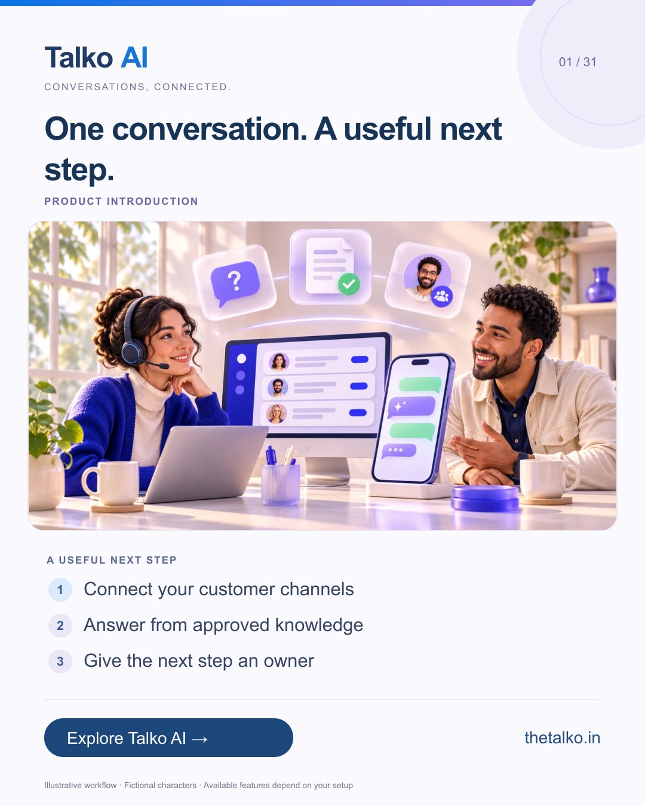

# 01 · One conversation. A useful next step.

Date: 2026-11-05
Pillar: Product introduction
Audience: Small business owners and customer teams
Status: ready to schedule (not uploaded to a social account)

## Linkedin

Suggested publish time: 2026-11-05 19:30 IST

Your next customer might arrive in a DM, a review or a website question.

The difficult part is keeping the context and deciding who should act next when those enquiries sit in separate places.

A practical workflow:
1. Connect your customer channels
2. Answer from approved knowledge
3. Give the next step an owner

Start with the channel that already brings you meaningful enquiries. Connecting every account on day one is not a requirement.

Talko AI brings messaging, AI answers and team ownership into a connected customer workflow.

Where does your team lose context today?

Explore the workflow: https://www.thetalko.in/features?utm_source=linkedin&utm_medium=organic_social&utm_campaign=2026-11_to_2027-01_character_workflows&utm_content=one-connected-workspace

#TalkoAI #CustomerExperience #BusinessAutomation

## Instagram

Suggested publish time: 2026-11-05 20:00 IST

Your next customer might arrive in a DM, a review or a website question.

The difficult part is keeping the context and deciding who should act next when those enquiries sit in separate places.

→ Connect your customer channels
→ Answer from approved knowledge
→ Give the next step an owner

Start with the channel that already brings you meaningful enquiries. Connecting every account on day one is not a requirement.

Talko AI brings messaging, AI answers and team ownership into a connected customer workflow.

Save this workflow for your next setup session. Explore Talko AI through the link in our bio.

Where does your team lose context today?

#TalkoAI #CustomerExperience #BusinessAutomation #SmallBusiness #CustomerSupport

## Facebook

Suggested publish time: 2026-11-05 19:00 IST

Your next customer might arrive in a DM, a review or a website question.

The difficult part is keeping the context and deciding who should act next when those enquiries sit in separate places.

Here is a useful place to start:
• Connect your customer channels
• Answer from approved knowledge
• Give the next step an owner

Talko AI brings messaging, AI answers and team ownership into a connected customer workflow. Start with the channel that already brings you meaningful enquiries. Connecting every account on day one is not a requirement.

Where does your team lose context today?

See how it works: https://www.thetalko.in/features?utm_source=facebook&utm_medium=organic_social&utm_campaign=2026-11_to_2027-01_character_workflows&utm_content=one-connected-workspace

#TalkoAI #CustomerExperience #BusinessAutomation

## Keywords and accessibility

Keywords: customer engagement platform, shared inbox, AI customer support, small business automation

Alt text: One conversation. A useful next step. A character-based illustration shows connect your customer channels, then answer from approved knowledge, then give the next step an owner.

## Instagram link setup

Feed caption links are not treated as clickable. Keep a stable profile link: https://www.thetalko.in/?utm_source=instagram&utm_medium=organic_social&utm_campaign=2026-11_to_2027-01_character_workflows&utm_content=profile

Use this post-specific URL in a Story link sticker or relevant link hub: https://www.thetalko.in/features?utm_source=instagram&utm_medium=organic_story&utm_campaign=2026-11_to_2027-01_character_workflows&utm_content=one-connected-workspace

Artwork source: public/marketing/stories/connected-team.webp
AI-generated editorial illustration; fictional people and illustrative workflows.
