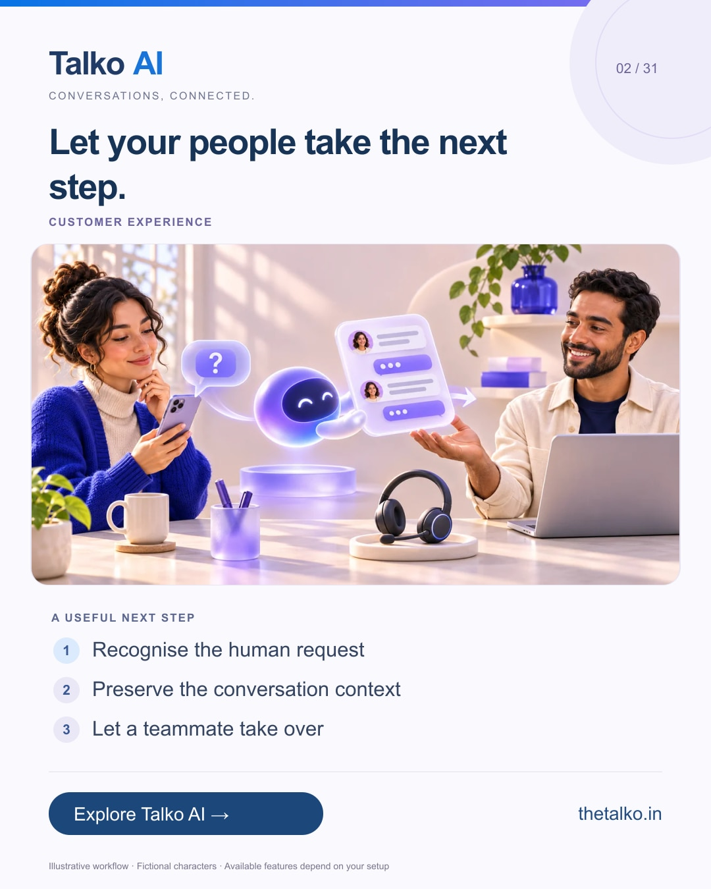

# 02 · Let your people take the next step.

Date: 2026-11-07
Pillar: Customer experience
Audience: Support managers and service teams
Status: ready to schedule (not uploaded to a social account)

## Linkedin

Suggested publish time: 2026-11-07 14:30 IST

“Can I speak to a person?” should lead somewhere useful.

A quick automated reply does not finish the job when a customer needs judgement, reassurance or an exception.

A practical workflow:
1. Recognise the human request
2. Preserve the conversation context
3. Let a teammate take over

Write down who owns handoffs during staffed hours and what the customer should expect outside those hours.

Use AI for approved answers and your team for the conversations that need a person.

What is the hardest part of your current support handoff?

Explore the workflow: https://www.thetalko.in/features?utm_source=linkedin&utm_medium=organic_social&utm_campaign=2026-11_to_2027-01_character_workflows&utm_content=human-handoff

#TalkoAI #CustomerExperience #BusinessAutomation

## Instagram

Suggested publish time: 2026-11-07 19:00 IST

“Can I speak to a person?” should lead somewhere useful.

A quick automated reply does not finish the job when a customer needs judgement, reassurance or an exception.

→ Recognise the human request
→ Preserve the conversation context
→ Let a teammate take over

Write down who owns handoffs during staffed hours and what the customer should expect outside those hours.

Use AI for approved answers and your team for the conversations that need a person.

Save this workflow for your next setup session. Explore Talko AI through the link in our bio.

What is the hardest part of your current support handoff?

#TalkoAI #CustomerExperience #BusinessAutomation #SmallBusiness #CustomerSupport

## Facebook

Suggested publish time: 2026-11-07 18:00 IST

“Can I speak to a person?” should lead somewhere useful.

A quick automated reply does not finish the job when a customer needs judgement, reassurance or an exception.

Here is a useful place to start:
• Recognise the human request
• Preserve the conversation context
• Let a teammate take over

Use AI for approved answers and your team for the conversations that need a person. Write down who owns handoffs during staffed hours and what the customer should expect outside those hours.

What is the hardest part of your current support handoff?

See how it works: https://www.thetalko.in/features?utm_source=facebook&utm_medium=organic_social&utm_campaign=2026-11_to_2027-01_character_workflows&utm_content=human-handoff

#TalkoAI #CustomerExperience #BusinessAutomation

## Keywords and accessibility

Keywords: AI to human handoff, customer support workflow, team inbox, conversation context

Alt text: Let your people take the next step. A character-based illustration shows recognise the human request, then preserve the conversation context, then let a teammate take over.

## Instagram link setup

Feed caption links are not treated as clickable. Keep a stable profile link: https://www.thetalko.in/?utm_source=instagram&utm_medium=organic_social&utm_campaign=2026-11_to_2027-01_character_workflows&utm_content=profile

Use this post-specific URL in a Story link sticker or relevant link hub: https://www.thetalko.in/features?utm_source=instagram&utm_medium=organic_story&utm_campaign=2026-11_to_2027-01_character_workflows&utm_content=human-handoff

Artwork source: public/marketing/stories/human-handoff.webp
AI-generated editorial illustration; fictional people and illustrative workflows.
