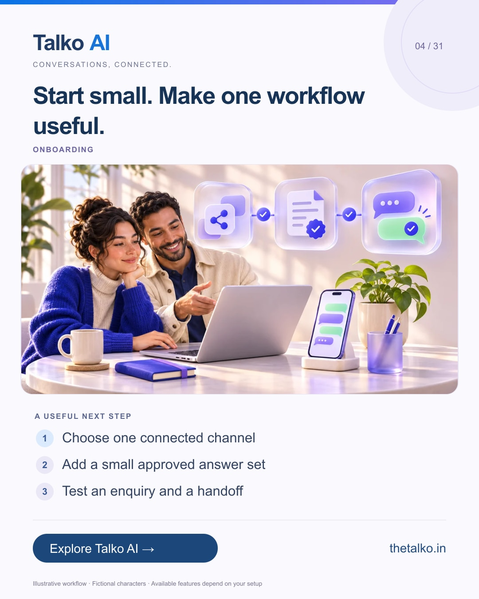

# 04 · Start small. Make one workflow useful.

Date: 2026-11-11
Pillar: Onboarding
Audience: Teams evaluating automation
Status: ready to schedule (not uploaded to a social account)

## Linkedin

Suggested publish time: 2026-11-11 14:30 IST

You do not need to automate the entire business to run a useful trial.

Connecting too many channels before testing one conversation can make it difficult to see what actually helps.

A practical workflow:
1. Choose one connected channel
2. Add a small approved answer set
3. Test an enquiry and a handoff

Include an unanswered question and a request for a person in your first test. The awkward cases are part of the workflow.

A focused Talko AI trial helps you evaluate the process your team will actually operate.

Which single workflow would you test first?

Explore the workflow: https://www.thetalko.in/signup?utm_source=linkedin&utm_medium=organic_social&utm_campaign=2026-11_to_2027-01_character_workflows&utm_content=first-workflow

#TalkoAI #WhatsAppAutomation #BusinessAutomation

## Instagram

Suggested publish time: 2026-11-11 19:00 IST

You do not need to automate the entire business to run a useful trial.

Connecting too many channels before testing one conversation can make it difficult to see what actually helps.

→ Choose one connected channel
→ Add a small approved answer set
→ Test an enquiry and a handoff

Include an unanswered question and a request for a person in your first test. The awkward cases are part of the workflow.

A focused Talko AI trial helps you evaluate the process your team will actually operate.

Save this workflow for your next setup session. Explore Talko AI through the link in our bio.

Which single workflow would you test first?

#TalkoAI #WhatsAppAutomation #BusinessAutomation #SmallBusiness #CustomerSupport

## Facebook

Suggested publish time: 2026-11-11 18:00 IST

You do not need to automate the entire business to run a useful trial.

Connecting too many channels before testing one conversation can make it difficult to see what actually helps.

Here is a useful place to start:
• Choose one connected channel
• Add a small approved answer set
• Test an enquiry and a handoff

A focused Talko AI trial helps you evaluate the process your team will actually operate. Include an unanswered question and a request for a person in your first test. The awkward cases are part of the workflow.

Which single workflow would you test first?

See how it works: https://www.thetalko.in/signup?utm_source=facebook&utm_medium=organic_social&utm_campaign=2026-11_to_2027-01_character_workflows&utm_content=first-workflow

#TalkoAI #WhatsAppAutomation #BusinessAutomation

## Keywords and accessibility

Keywords: WhatsApp automation trial, chatbot setup, customer support onboarding, automation pilot

Alt text: Start small. Make one workflow useful. A character-based illustration shows choose one connected channel, then add a small approved answer set, then test an enquiry and a handoff.

## Instagram link setup

Feed caption links are not treated as clickable. Keep a stable profile link: https://www.thetalko.in/?utm_source=instagram&utm_medium=organic_social&utm_campaign=2026-11_to_2027-01_character_workflows&utm_content=profile

Use this post-specific URL in a Story link sticker or relevant link hub: https://www.thetalko.in/signup?utm_source=instagram&utm_medium=organic_story&utm_campaign=2026-11_to_2027-01_character_workflows&utm_content=first-workflow

Artwork source: public/marketing/stories/getting-started.webp
AI-generated editorial illustration; fictional people and illustrative workflows.
