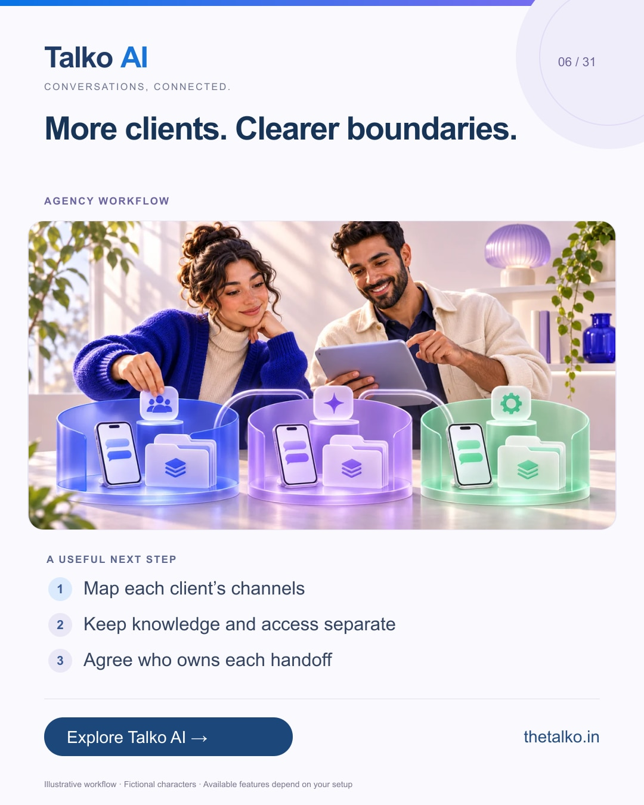

# 06 · More clients. Clearer boundaries.

Date: 2026-11-15
Pillar: Agency workflow
Audience: Agencies and multi-brand teams
Status: ready to schedule (not uploaded to a social account)

## Linkedin

Suggested publish time: 2026-11-15 14:30 IST

A multi-client service starts with clear ownership, not another copied prompt.

Client channels, knowledge, credentials and follow-up responsibilities need to stay organised as your agency grows.

A practical workflow:
1. Map each client’s channels
2. Keep knowledge and access separate
3. Agree who owns each handoff

Confirm account structure, plan fit and commercial terms before promising white-labelling or resale rights.

Scope a repeatable customer-conversation workflow around each client’s actual business.

Which onboarding responsibility causes the most confusion for your clients?

Explore the workflow: https://www.thetalko.in/contact?utm_source=linkedin&utm_medium=organic_social&utm_campaign=2026-11_to_2027-01_character_workflows&utm_content=agency-client-boundaries

#TalkoAI #WhatsAppAutomation #BusinessAutomation

## Instagram

Suggested publish time: 2026-11-15 19:00 IST

A multi-client service starts with clear ownership, not another copied prompt.

Client channels, knowledge, credentials and follow-up responsibilities need to stay organised as your agency grows.

→ Map each client’s channels
→ Keep knowledge and access separate
→ Agree who owns each handoff

Confirm account structure, plan fit and commercial terms before promising white-labelling or resale rights.

Scope a repeatable customer-conversation workflow around each client’s actual business.

Save this workflow for your next setup session. Explore Talko AI through the link in our bio.

Which onboarding responsibility causes the most confusion for your clients?

#TalkoAI #WhatsAppAutomation #BusinessAutomation #SmallBusiness #CustomerSupport

## Facebook

Suggested publish time: 2026-11-15 18:00 IST

A multi-client service starts with clear ownership, not another copied prompt.

Client channels, knowledge, credentials and follow-up responsibilities need to stay organised as your agency grows.

Here is a useful place to start:
• Map each client’s channels
• Keep knowledge and access separate
• Agree who owns each handoff

Scope a repeatable customer-conversation workflow around each client’s actual business. Confirm account structure, plan fit and commercial terms before promising white-labelling or resale rights.

Which onboarding responsibility causes the most confusion for your clients?

See how it works: https://www.thetalko.in/contact?utm_source=facebook&utm_medium=organic_social&utm_campaign=2026-11_to_2027-01_character_workflows&utm_content=agency-client-boundaries

#TalkoAI #WhatsAppAutomation #BusinessAutomation

## Keywords and accessibility

Keywords: agency WhatsApp automation, multi-brand customer support, client onboarding, workspace isolation

Alt text: More clients. Clearer boundaries. A character-based illustration shows map each client’s channels, then keep knowledge and access separate, then agree who owns each handoff.

## Instagram link setup

Feed caption links are not treated as clickable. Keep a stable profile link: https://www.thetalko.in/?utm_source=instagram&utm_medium=organic_social&utm_campaign=2026-11_to_2027-01_character_workflows&utm_content=profile

Use this post-specific URL in a Story link sticker or relevant link hub: https://www.thetalko.in/contact?utm_source=instagram&utm_medium=organic_story&utm_campaign=2026-11_to_2027-01_character_workflows&utm_content=agency-client-boundaries

Artwork source: public/marketing/stories/agency-workspaces.webp
AI-generated editorial illustration; fictional people and illustrative workflows.
