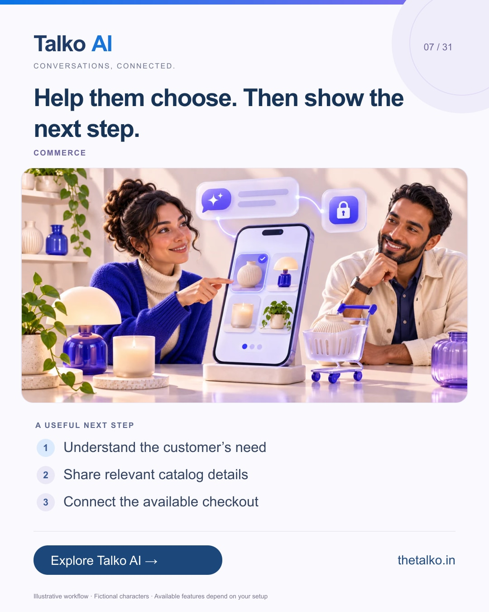

# 07 · Help them choose. Then show the next step.

Date: 2026-11-17
Pillar: Commerce
Audience: Retail and D2C teams
Status: ready to schedule (not uploaded to a social account)

## Linkedin

Suggested publish time: 2026-11-17 19:30 IST

A product question is a chance to help someone decide.

Shoppers may need an explanation of sizes, options or the checkout process before they are ready to buy.

A practical workflow:
1. Understand the customer’s need
2. Share relevant catalog details
3. Connect the available checkout

Verify stock, delivery and payment information through the correct business source. Do not let an assistant guess.

Bring catalog conversations, AI answers and a human exception path into one commerce workflow.

Which product question appears most often before a purchase?

Explore the workflow: https://www.thetalko.in/industries/ecommerce?utm_source=linkedin&utm_medium=organic_social&utm_campaign=2026-11_to_2027-01_character_workflows&utm_content=help-customers-choose

#TalkoAI #WhatsAppAutomation #BusinessAutomation

## Instagram

Suggested publish time: 2026-11-17 20:00 IST

A product question is a chance to help someone decide.

Shoppers may need an explanation of sizes, options or the checkout process before they are ready to buy.

→ Understand the customer’s need
→ Share relevant catalog details
→ Connect the available checkout

Verify stock, delivery and payment information through the correct business source. Do not let an assistant guess.

Bring catalog conversations, AI answers and a human exception path into one commerce workflow.

Save this workflow for your next setup session. Explore Talko AI through the link in our bio.

Which product question appears most often before a purchase?

#TalkoAI #WhatsAppAutomation #BusinessAutomation #SmallBusiness #CustomerSupport

## Facebook

Suggested publish time: 2026-11-17 19:00 IST

A product question is a chance to help someone decide.

Shoppers may need an explanation of sizes, options or the checkout process before they are ready to buy.

Here is a useful place to start:
• Understand the customer’s need
• Share relevant catalog details
• Connect the available checkout

Bring catalog conversations, AI answers and a human exception path into one commerce workflow. Verify stock, delivery and payment information through the correct business source. Do not let an assistant guess.

Which product question appears most often before a purchase?

See how it works: https://www.thetalko.in/industries/ecommerce?utm_source=facebook&utm_medium=organic_social&utm_campaign=2026-11_to_2027-01_character_workflows&utm_content=help-customers-choose

#TalkoAI #WhatsAppAutomation #BusinessAutomation

## Keywords and accessibility

Keywords: conversational commerce, WhatsApp catalog, product recommendation workflow, chat checkout

Alt text: Help them choose. Then show the next step. A character-based illustration shows understand the customer’s need, then share relevant catalog details, then connect the available checkout.

## Instagram link setup

Feed caption links are not treated as clickable. Keep a stable profile link: https://www.thetalko.in/?utm_source=instagram&utm_medium=organic_social&utm_campaign=2026-11_to_2027-01_character_workflows&utm_content=profile

Use this post-specific URL in a Story link sticker or relevant link hub: https://www.thetalko.in/industries/ecommerce?utm_source=instagram&utm_medium=organic_story&utm_campaign=2026-11_to_2027-01_character_workflows&utm_content=help-customers-choose

Artwork source: public/marketing/stories/commerce-guide.webp
AI-generated editorial illustration; fictional people and illustrative workflows.
