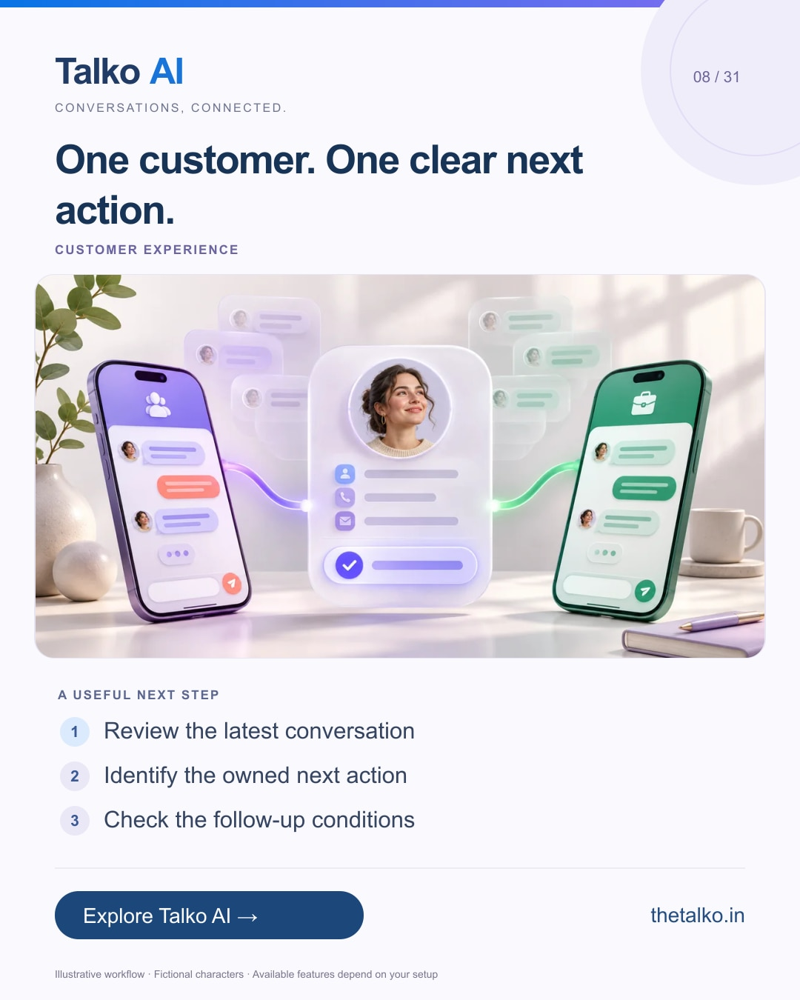

# 08 · One customer. One clear next action.

Date: 2026-11-19
Pillar: Customer experience
Audience: Sales and lifecycle marketing teams
Status: ready to schedule (not uploaded to a social account)

## Linkedin

Suggested publish time: 2026-11-19 14:30 IST

Two channels should not mean two conflicting follow-ups.

When a customer has already replied or moved to the next step, an old message can make your process feel disconnected.

A practical workflow:
1. Review the latest conversation
2. Identify the owned next action
3. Check the follow-up conditions

Test what happens after a reply, purchase or request to stop. Channel rules and the workflow configuration still apply.

Design follow-up around customer context instead of treating every channel as a separate sales opportunity.

Where do duplicate messages tend to appear in your process?

Explore the workflow: https://www.thetalko.in/features?utm_source=linkedin&utm_medium=organic_social&utm_campaign=2026-11_to_2027-01_character_workflows&utm_content=avoid-duplicate-follow-up

#TalkoAI #CustomerExperience #BusinessAutomation

## Instagram

Suggested publish time: 2026-11-19 19:00 IST

Two channels should not mean two conflicting follow-ups.

When a customer has already replied or moved to the next step, an old message can make your process feel disconnected.

→ Review the latest conversation
→ Identify the owned next action
→ Check the follow-up conditions

Test what happens after a reply, purchase or request to stop. Channel rules and the workflow configuration still apply.

Design follow-up around customer context instead of treating every channel as a separate sales opportunity.

Save this workflow for your next setup session. Explore Talko AI through the link in our bio.

Where do duplicate messages tend to appear in your process?

#TalkoAI #CustomerExperience #BusinessAutomation #SmallBusiness #CustomerSupport

## Facebook

Suggested publish time: 2026-11-19 18:00 IST

Two channels should not mean two conflicting follow-ups.

When a customer has already replied or moved to the next step, an old message can make your process feel disconnected.

Here is a useful place to start:
• Review the latest conversation
• Identify the owned next action
• Check the follow-up conditions

Design follow-up around customer context instead of treating every channel as a separate sales opportunity. Test what happens after a reply, purchase or request to stop. Channel rules and the workflow configuration still apply.

Where do duplicate messages tend to appear in your process?

See how it works: https://www.thetalko.in/features?utm_source=facebook&utm_medium=organic_social&utm_campaign=2026-11_to_2027-01_character_workflows&utm_content=avoid-duplicate-follow-up

#TalkoAI #CustomerExperience #BusinessAutomation

## Keywords and accessibility

Keywords: cross-channel follow-up, duplicate message prevention, customer journey, sales follow-up

Alt text: One customer. One clear next action. A character-based illustration shows review the latest conversation, then identify the owned next action, then check the follow-up conditions.

## Instagram link setup

Feed caption links are not treated as clickable. Keep a stable profile link: https://www.thetalko.in/?utm_source=instagram&utm_medium=organic_social&utm_campaign=2026-11_to_2027-01_character_workflows&utm_content=profile

Use this post-specific URL in a Story link sticker or relevant link hub: https://www.thetalko.in/features?utm_source=instagram&utm_medium=organic_story&utm_campaign=2026-11_to_2027-01_character_workflows&utm_content=avoid-duplicate-follow-up

Artwork source: public/blog/instagram-whatsapp-follow-up-without-duplicate-messages.webp
AI-generated editorial illustration; fictional people and illustrative workflows.
