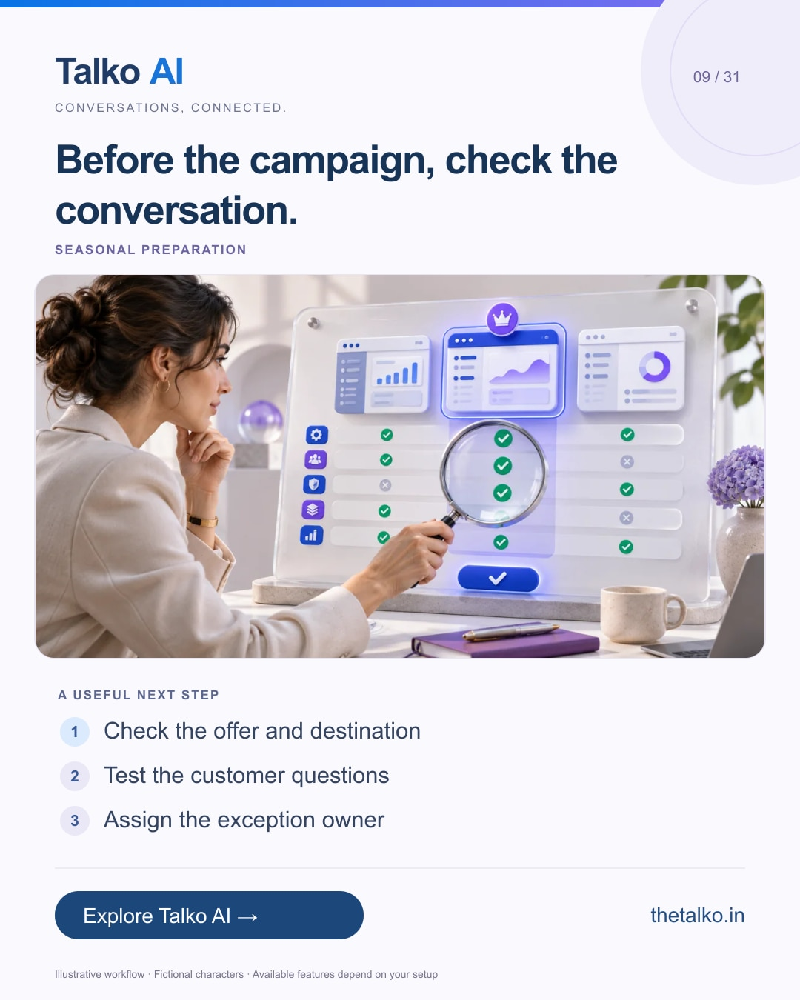

# 09 · Before the campaign, check the conversation.

Date: 2026-11-21
Pillar: Seasonal preparation
Audience: Teams preparing Black Friday campaigns
Status: ready to schedule (not uploaded to a social account)

## Linkedin

Suggested publish time: 2026-11-21 19:30 IST

Your Black Friday creative is ready. Is the next conversation ready too?

A strong offer can still produce a weak experience if product facts, links and human ownership are unclear.

A practical workflow:
1. Check the offer and destination
2. Test the customer questions
3. Assign the exception owner

Run the same acceptance test on mobile, with an unclear question and a request for a person. Keep the test small enough to inspect.

Use Talko AI to connect the campaign context with replies and the team’s next action.

What must work before your next promotion goes live?

Explore the workflow: https://www.thetalko.in/features?utm_source=linkedin&utm_medium=organic_social&utm_campaign=2026-11_to_2027-01_character_workflows&utm_content=campaign-readiness

#TalkoAI #WhatsAppAutomation #BusinessAutomation

## Instagram

Suggested publish time: 2026-11-21 20:00 IST

Your Black Friday creative is ready. Is the next conversation ready too?

A strong offer can still produce a weak experience if product facts, links and human ownership are unclear.

→ Check the offer and destination
→ Test the customer questions
→ Assign the exception owner

Run the same acceptance test on mobile, with an unclear question and a request for a person. Keep the test small enough to inspect.

Use Talko AI to connect the campaign context with replies and the team’s next action.

Save this workflow for your next setup session. Explore Talko AI through the link in our bio.

What must work before your next promotion goes live?

#TalkoAI #WhatsAppAutomation #BusinessAutomation #SmallBusiness #CustomerSupport

## Facebook

Suggested publish time: 2026-11-21 19:00 IST

Your Black Friday creative is ready. Is the next conversation ready too?

A strong offer can still produce a weak experience if product facts, links and human ownership are unclear.

Here is a useful place to start:
• Check the offer and destination
• Test the customer questions
• Assign the exception owner

Use Talko AI to connect the campaign context with replies and the team’s next action. Run the same acceptance test on mobile, with an unclear question and a request for a person. Keep the test small enough to inspect.

What must work before your next promotion goes live?

See how it works: https://www.thetalko.in/features?utm_source=facebook&utm_medium=organic_social&utm_campaign=2026-11_to_2027-01_character_workflows&utm_content=campaign-readiness

#TalkoAI #WhatsAppAutomation #BusinessAutomation

## Keywords and accessibility

Keywords: Black Friday customer support, campaign readiness checklist, WhatsApp marketing workflow, lead qualification

Alt text: Before the campaign, check the conversation. A character-based illustration shows check the offer and destination, then test the customer questions, then assign the exception owner.

## Instagram link setup

Feed caption links are not treated as clickable. Keep a stable profile link: https://www.thetalko.in/?utm_source=instagram&utm_medium=organic_social&utm_campaign=2026-11_to_2027-01_character_workflows&utm_content=profile

Use this post-specific URL in a Story link sticker or relevant link hub: https://www.thetalko.in/features?utm_source=instagram&utm_medium=organic_story&utm_campaign=2026-11_to_2027-01_character_workflows&utm_content=campaign-readiness

Artwork source: public/blog/choose-whatsapp-automation-platform-checklist.webp
AI-generated editorial illustration; fictional people and illustrative workflows.
