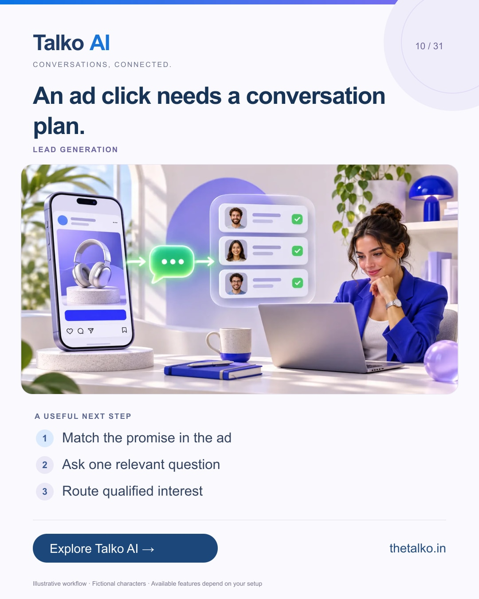

# 10 · An ad click needs a conversation plan.

Date: 2026-11-23
Pillar: Lead generation
Audience: Performance marketers and sales owners
Status: ready to schedule (not uploaded to a social account)

## Linkedin

Suggested publish time: 2026-11-23 14:30 IST

Chat volume is not the same as a qualified opportunity.

An ad can start a conversation, but the opening reply still needs to match the offer and establish a useful next step.

A practical workflow:
1. Match the promise in the ad
2. Ask one relevant question
3. Route qualified interest

Define qualification before comparing campaign results. A person opening a chat is not yet a completed appointment or sale.

Connect campaign-aware answers, qualification and the shared inbox in Talko AI.

What makes a conversation qualified for your sales team?

Explore the workflow: https://www.thetalko.in/features?utm_source=linkedin&utm_medium=organic_social&utm_campaign=2026-11_to_2027-01_character_workflows&utm_content=ads-to-useful-enquiries#social-growth

#TalkoAI #WhatsAppAutomation #BusinessAutomation

## Instagram

Suggested publish time: 2026-11-23 19:00 IST

Chat volume is not the same as a qualified opportunity.

An ad can start a conversation, but the opening reply still needs to match the offer and establish a useful next step.

→ Match the promise in the ad
→ Ask one relevant question
→ Route qualified interest

Define qualification before comparing campaign results. A person opening a chat is not yet a completed appointment or sale.

Connect campaign-aware answers, qualification and the shared inbox in Talko AI.

Save this workflow for your next setup session. Explore Talko AI through the link in our bio.

What makes a conversation qualified for your sales team?

#TalkoAI #WhatsAppAutomation #BusinessAutomation #SmallBusiness #CustomerSupport

## Facebook

Suggested publish time: 2026-11-23 18:00 IST

Chat volume is not the same as a qualified opportunity.

An ad can start a conversation, but the opening reply still needs to match the offer and establish a useful next step.

Here is a useful place to start:
• Match the promise in the ad
• Ask one relevant question
• Route qualified interest

Connect campaign-aware answers, qualification and the shared inbox in Talko AI. Define qualification before comparing campaign results. A person opening a chat is not yet a completed appointment or sale.

What makes a conversation qualified for your sales team?

See how it works: https://www.thetalko.in/features?utm_source=facebook&utm_medium=organic_social&utm_campaign=2026-11_to_2027-01_character_workflows&utm_content=ads-to-useful-enquiries#social-growth

#TalkoAI #WhatsAppAutomation #BusinessAutomation

## Keywords and accessibility

Keywords: click to WhatsApp ads, qualified leads, ad to chat funnel, campaign-aware AI

Alt text: An ad click needs a conversation plan. A character-based illustration shows match the promise in the ad, then ask one relevant question, then route qualified interest.

## Instagram link setup

Feed caption links are not treated as clickable. Keep a stable profile link: https://www.thetalko.in/?utm_source=instagram&utm_medium=organic_social&utm_campaign=2026-11_to_2027-01_character_workflows&utm_content=profile

Use this post-specific URL in a Story link sticker or relevant link hub: https://www.thetalko.in/features?utm_source=instagram&utm_medium=organic_story&utm_campaign=2026-11_to_2027-01_character_workflows&utm_content=ads-to-useful-enquiries#social-growth

Artwork source: public/blog/click-to-whatsapp-ads-qualified-leads.webp
AI-generated editorial illustration; fictional people and illustrative workflows.
