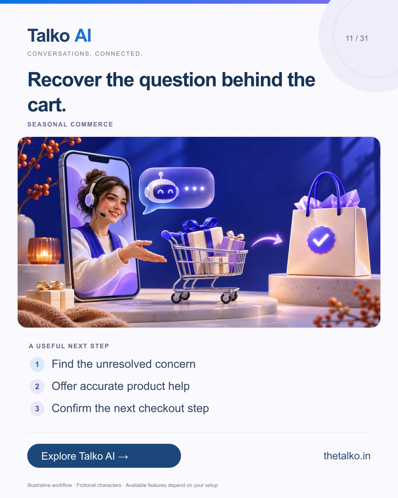

# 11 · Recover the question behind the cart.

Date: 2026-11-25
Pillar: Seasonal commerce
Audience: Retail teams before Black Friday
Status: ready to schedule (not uploaded to a social account)

## Linkedin

Suggested publish time: 2026-11-25 19:30 IST

A cart reminder works better when it resolves the buying concern.

A shopper may be unsure about fit, delivery or payment. Repeating “buy now” does not answer those questions.

A practical workflow:
1. Find the unresolved concern
2. Offer accurate product help
3. Confirm the next checkout step

Test your completion and opt-out conditions before launching reminders. A cart event does not remove messaging-permission requirements.

Combine catalog support, relevant follow-up and human help around the shopper’s actual decision.

What question most often keeps your shoppers from checking out?

Explore the workflow: https://www.thetalko.in/industries/ecommerce?utm_source=linkedin&utm_medium=organic_social&utm_campaign=2026-11_to_2027-01_character_workflows&utm_content=black-friday-cart-help

#TalkoAI #WhatsAppAutomation #BusinessAutomation

## Instagram

Suggested publish time: 2026-11-25 20:00 IST

A cart reminder works better when it resolves the buying concern.

A shopper may be unsure about fit, delivery or payment. Repeating “buy now” does not answer those questions.

→ Find the unresolved concern
→ Offer accurate product help
→ Confirm the next checkout step

Test your completion and opt-out conditions before launching reminders. A cart event does not remove messaging-permission requirements.

Combine catalog support, relevant follow-up and human help around the shopper’s actual decision.

Save this workflow for your next setup session. Explore Talko AI through the link in our bio.

What question most often keeps your shoppers from checking out?

#TalkoAI #WhatsAppAutomation #BusinessAutomation #SmallBusiness #CustomerSupport

## Facebook

Suggested publish time: 2026-11-25 19:00 IST

A cart reminder works better when it resolves the buying concern.

A shopper may be unsure about fit, delivery or payment. Repeating “buy now” does not answer those questions.

Here is a useful place to start:
• Find the unresolved concern
• Offer accurate product help
• Confirm the next checkout step

Combine catalog support, relevant follow-up and human help around the shopper’s actual decision. Test your completion and opt-out conditions before launching reminders. A cart event does not remove messaging-permission requirements.

What question most often keeps your shoppers from checking out?

See how it works: https://www.thetalko.in/industries/ecommerce?utm_source=facebook&utm_medium=organic_social&utm_campaign=2026-11_to_2027-01_character_workflows&utm_content=black-friday-cart-help

#TalkoAI #WhatsAppAutomation #BusinessAutomation

## Keywords and accessibility

Keywords: Black Friday cart recovery, WhatsApp abandoned cart, ecommerce support, checkout questions

Alt text: Recover the question behind the cart. A character-based illustration shows find the unresolved concern, then offer accurate product help, then confirm the next checkout step.

## Instagram link setup

Feed caption links are not treated as clickable. Keep a stable profile link: https://www.thetalko.in/?utm_source=instagram&utm_medium=organic_social&utm_campaign=2026-11_to_2027-01_character_workflows&utm_content=profile

Use this post-specific URL in a Story link sticker or relevant link hub: https://www.thetalko.in/industries/ecommerce?utm_source=instagram&utm_medium=organic_story&utm_campaign=2026-11_to_2027-01_character_workflows&utm_content=black-friday-cart-help

Artwork source: public/blog/black-friday-whatsapp-cart-recovery-workflow.webp
AI-generated editorial illustration; fictional people and illustrative workflows.
