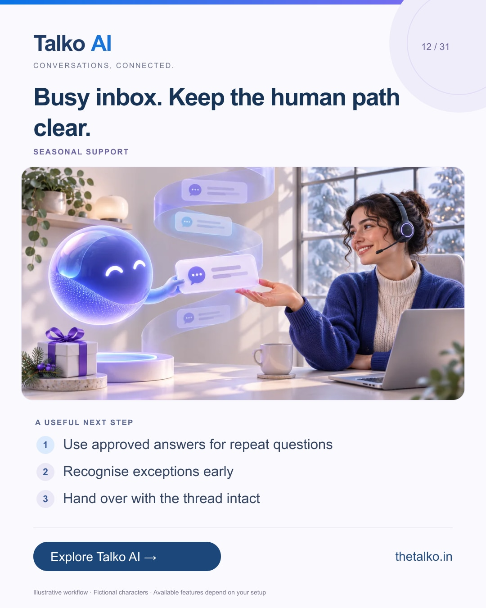

# 12 · Busy inbox. Keep the human path clear.

Date: 2026-11-27
Pillar: Seasonal support
Audience: Retail customer service managers
Status: ready to schedule (not uploaded to a social account)

## Linkedin

Suggested publish time: 2026-11-27 14:30 IST

A busy shopping day makes clear ownership more valuable.

Your team needs to know which enquiries AI can answer and which ones need someone to make a decision.

A practical workflow:
1. Use approved answers for repeat questions
2. Recognise exceptions early
3. Hand over with the thread intact

Publish accurate support hours and maintain a named handoff owner. Do not promise always-available staff unless you actually provide them.

Let Talko AI support the repeatable work while your people handle the cases that need judgement.

Which questions should reach a person immediately?

Explore the workflow: https://www.thetalko.in/features?utm_source=linkedin&utm_medium=organic_social&utm_campaign=2026-11_to_2027-01_character_workflows&utm_content=black-friday-human-support

#TalkoAI #CustomerExperience #BusinessAutomation

## Instagram

Suggested publish time: 2026-11-27 19:00 IST

A busy shopping day makes clear ownership more valuable.

Your team needs to know which enquiries AI can answer and which ones need someone to make a decision.

→ Use approved answers for repeat questions
→ Recognise exceptions early
→ Hand over with the thread intact

Publish accurate support hours and maintain a named handoff owner. Do not promise always-available staff unless you actually provide them.

Let Talko AI support the repeatable work while your people handle the cases that need judgement.

Save this workflow for your next setup session. Explore Talko AI through the link in our bio.

Which questions should reach a person immediately?

#TalkoAI #CustomerExperience #BusinessAutomation #SmallBusiness #CustomerSupport

## Facebook

Suggested publish time: 2026-11-27 18:00 IST

A busy shopping day makes clear ownership more valuable.

Your team needs to know which enquiries AI can answer and which ones need someone to make a decision.

Here is a useful place to start:
• Use approved answers for repeat questions
• Recognise exceptions early
• Hand over with the thread intact

Let Talko AI support the repeatable work while your people handle the cases that need judgement. Publish accurate support hours and maintain a named handoff owner. Do not promise always-available staff unless you actually provide them.

Which questions should reach a person immediately?

See how it works: https://www.thetalko.in/features?utm_source=facebook&utm_medium=organic_social&utm_campaign=2026-11_to_2027-01_character_workflows&utm_content=black-friday-human-support

#TalkoAI #CustomerExperience #BusinessAutomation

## Keywords and accessibility

Keywords: holiday support automation, AI human handoff, Black Friday inbox, customer service operations

Alt text: Busy inbox. Keep the human path clear. A character-based illustration shows use approved answers for repeat questions, then recognise exceptions early, then hand over with the thread intact.

## Instagram link setup

Feed caption links are not treated as clickable. Keep a stable profile link: https://www.thetalko.in/?utm_source=instagram&utm_medium=organic_social&utm_campaign=2026-11_to_2027-01_character_workflows&utm_content=profile

Use this post-specific URL in a Story link sticker or relevant link hub: https://www.thetalko.in/features?utm_source=instagram&utm_medium=organic_story&utm_campaign=2026-11_to_2027-01_character_workflows&utm_content=black-friday-human-support

Artwork source: public/blog/holiday-customer-support-ai-human-handoff.webp
AI-generated editorial illustration; fictional people and illustrative workflows.
