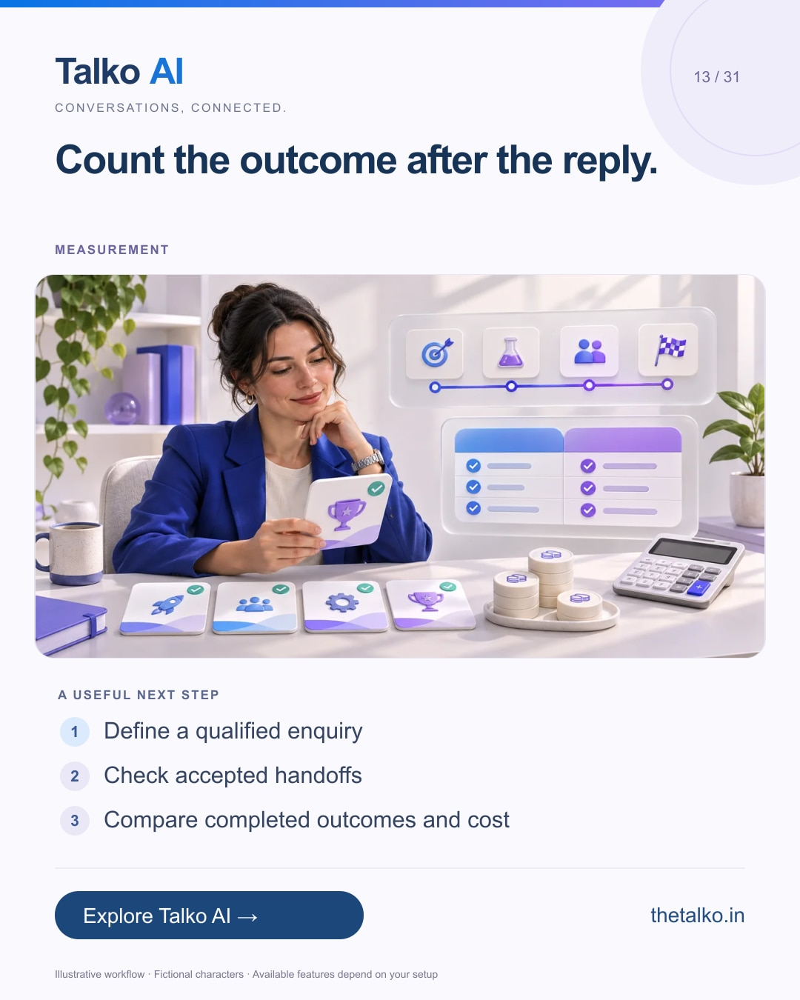

# 13 · Count the outcome after the reply.

Date: 2026-11-29
Pillar: Measurement
Audience: Founders and marketing operators
Status: ready to schedule (not uploaded to a social account)

## Linkedin

Suggested publish time: 2026-11-29 19:30 IST

A reply is an activity. A completed next step is an outcome.

A growing message count can hide qualified leads that wait unattended or appointments that never happen.

A practical workflow:
1. Define a qualified enquiry
2. Check accepted handoffs
3. Compare completed outcomes and cost

Use a baseline and comparable conditions. Seasonal demand or higher ad spend can change results without an automation improvement.

Evaluate a Talko AI workflow with the business result and operating effort visible together.

Which outcome would justify expanding your first automation?

Explore the workflow: https://www.thetalko.in/contact?utm_source=linkedin&utm_medium=organic_social&utm_campaign=2026-11_to_2027-01_character_workflows&utm_content=measure-the-next-step

#TalkoAI #CustomerExperience #BusinessAutomation

## Instagram

Suggested publish time: 2026-11-29 20:00 IST

A reply is an activity. A completed next step is an outcome.

A growing message count can hide qualified leads that wait unattended or appointments that never happen.

→ Define a qualified enquiry
→ Check accepted handoffs
→ Compare completed outcomes and cost

Use a baseline and comparable conditions. Seasonal demand or higher ad spend can change results without an automation improvement.

Evaluate a Talko AI workflow with the business result and operating effort visible together.

Save this workflow for your next setup session. Explore Talko AI through the link in our bio.

Which outcome would justify expanding your first automation?

#TalkoAI #CustomerExperience #BusinessAutomation #SmallBusiness #CustomerSupport

## Facebook

Suggested publish time: 2026-11-29 19:00 IST

A reply is an activity. A completed next step is an outcome.

A growing message count can hide qualified leads that wait unattended or appointments that never happen.

Here is a useful place to start:
• Define a qualified enquiry
• Check accepted handoffs
• Compare completed outcomes and cost

Evaluate a Talko AI workflow with the business result and operating effort visible together. Use a baseline and comparable conditions. Seasonal demand or higher ad spend can change results without an automation improvement.

Which outcome would justify expanding your first automation?

See how it works: https://www.thetalko.in/contact?utm_source=facebook&utm_medium=organic_social&utm_campaign=2026-11_to_2027-01_character_workflows&utm_content=measure-the-next-step

#TalkoAI #CustomerExperience #BusinessAutomation

## Keywords and accessibility

Keywords: automation ROI, qualified lead measurement, customer support metrics, 30 day pilot

Alt text: Count the outcome after the reply. A character-based illustration shows define a qualified enquiry, then check accepted handoffs, then compare completed outcomes and cost.

## Instagram link setup

Feed caption links are not treated as clickable. Keep a stable profile link: https://www.thetalko.in/?utm_source=instagram&utm_medium=organic_social&utm_campaign=2026-11_to_2027-01_character_workflows&utm_content=profile

Use this post-specific URL in a Story link sticker or relevant link hub: https://www.thetalko.in/contact?utm_source=instagram&utm_medium=organic_story&utm_campaign=2026-11_to_2027-01_character_workflows&utm_content=measure-the-next-step

Artwork source: public/blog/whatsapp-automation-roi-30-day-pilot.webp
AI-generated editorial illustration; fictional people and illustrative workflows.
