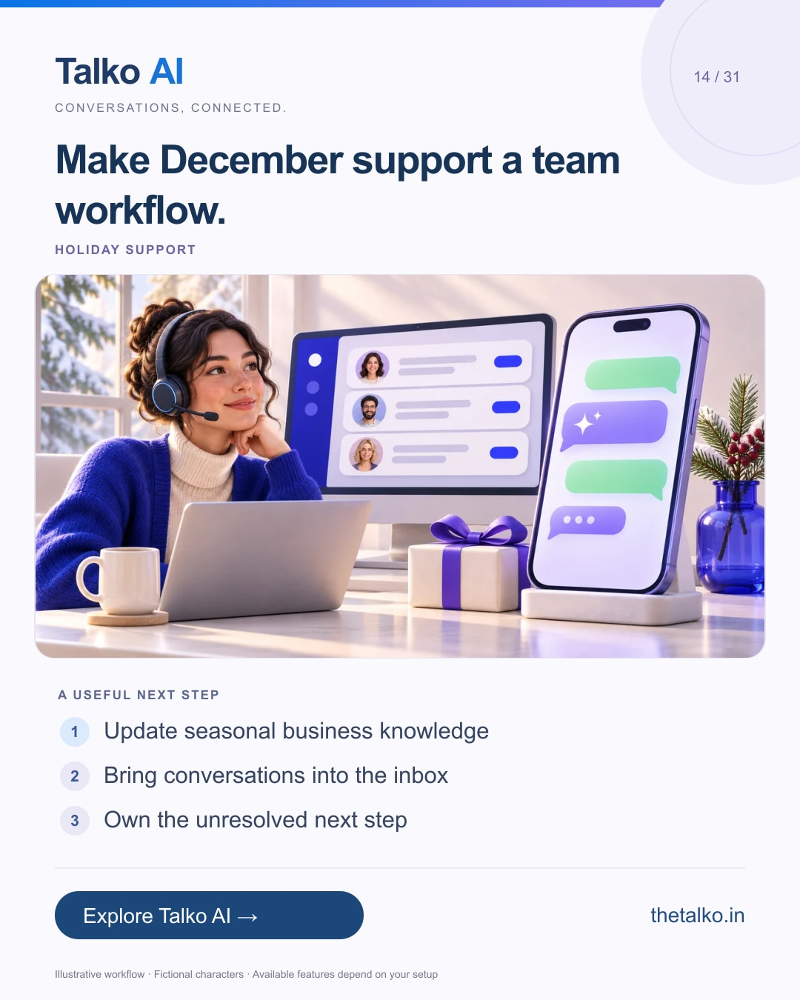

# 14 · Make December support a team workflow.

Date: 2026-12-01
Pillar: Holiday support
Audience: Small businesses and support teams
Status: ready to schedule (not uploaded to a social account)

## Linkedin

Suggested publish time: 2026-12-01 14:30 IST

Holiday support needs current answers and a clear owner.

Opening hours, delivery questions and seasonal offers change quickly. The team needs one dependable way to keep the conversation moving.

A practical workflow:
1. Update seasonal business knowledge
2. Bring conversations into the inbox
3. Own the unresolved next step

Give temporary offers an expiry date. Remove an old instruction when the promotion ends instead of expecting AI to infer the change.

Connect AI answers, a shared inbox and team assignment for the December customer journey.

Which seasonal answer needs an update before customers start asking?

Explore the workflow: https://www.thetalko.in/features?utm_source=linkedin&utm_medium=organic_social&utm_campaign=2026-11_to_2027-01_character_workflows&utm_content=holiday-inbox

#TalkoAI #InstagramAutomation #BusinessAutomation

## Instagram

Suggested publish time: 2026-12-01 19:00 IST

Holiday support needs current answers and a clear owner.

Opening hours, delivery questions and seasonal offers change quickly. The team needs one dependable way to keep the conversation moving.

→ Update seasonal business knowledge
→ Bring conversations into the inbox
→ Own the unresolved next step

Give temporary offers an expiry date. Remove an old instruction when the promotion ends instead of expecting AI to infer the change.

Connect AI answers, a shared inbox and team assignment for the December customer journey.

Save this workflow for your next setup session. Explore Talko AI through the link in our bio.

Which seasonal answer needs an update before customers start asking?

#TalkoAI #InstagramAutomation #BusinessAutomation #SmallBusiness #CustomerSupport

## Facebook

Suggested publish time: 2026-12-01 18:00 IST

Holiday support needs current answers and a clear owner.

Opening hours, delivery questions and seasonal offers change quickly. The team needs one dependable way to keep the conversation moving.

Here is a useful place to start:
• Update seasonal business knowledge
• Bring conversations into the inbox
• Own the unresolved next step

Connect AI answers, a shared inbox and team assignment for the December customer journey. Give temporary offers an expiry date. Remove an old instruction when the promotion ends instead of expecting AI to infer the change.

Which seasonal answer needs an update before customers start asking?

See how it works: https://www.thetalko.in/features?utm_source=facebook&utm_medium=organic_social&utm_campaign=2026-11_to_2027-01_character_workflows&utm_content=holiday-inbox

#TalkoAI #InstagramAutomation #BusinessAutomation

## Keywords and accessibility

Keywords: holiday customer support, shared WhatsApp inbox, Instagram customer care, seasonal FAQs

Alt text: Make December support a team workflow. A character-based illustration shows update seasonal business knowledge, then bring conversations into the inbox, then own the unresolved next step.

## Instagram link setup

Feed caption links are not treated as clickable. Keep a stable profile link: https://www.thetalko.in/?utm_source=instagram&utm_medium=organic_social&utm_campaign=2026-11_to_2027-01_character_workflows&utm_content=profile

Use this post-specific URL in a Story link sticker or relevant link hub: https://www.thetalko.in/features?utm_source=instagram&utm_medium=organic_story&utm_campaign=2026-11_to_2027-01_character_workflows&utm_content=holiday-inbox

Artwork source: public/blog/holiday-customer-support-whatsapp-instagram-ai-inbox.webp
AI-generated editorial illustration; fictional people and illustrative workflows.
