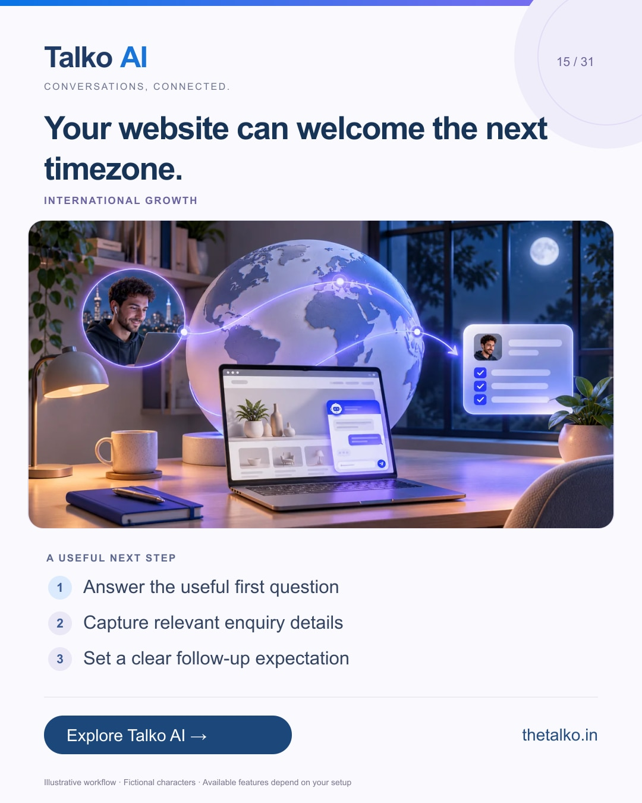

# 15 · Your website can welcome the next timezone.

Date: 2026-12-03
Pillar: International growth
Audience: Businesses serving overseas customers
Status: ready to schedule (not uploaded to a social account)

## Linkedin

Suggested publish time: 2026-12-03 19:30 IST

An overseas visitor should not have to guess how to reach you.

After-hours enquiries need approved information, a way to share relevant details and an honest explanation of when your team responds.

A practical workflow:
1. Answer the useful first question
2. Capture relevant enquiry details
3. Set a clear follow-up expectation

State your staffed hours with a timezone. Automated availability and human availability are different service commitments.

Use Talko AI website chat and the shared inbox to make international enquiries actionable.

Which visitor timezone is hardest for your current team to cover?

Explore the workflow: https://www.thetalko.in/features?utm_source=linkedin&utm_medium=organic_social&utm_campaign=2026-11_to_2027-01_character_workflows&utm_content=after-hours-enquiries

#TalkoAI #CustomerExperience #BusinessAutomation

## Instagram

Suggested publish time: 2026-12-03 20:00 IST

An overseas visitor should not have to guess how to reach you.

After-hours enquiries need approved information, a way to share relevant details and an honest explanation of when your team responds.

→ Answer the useful first question
→ Capture relevant enquiry details
→ Set a clear follow-up expectation

State your staffed hours with a timezone. Automated availability and human availability are different service commitments.

Use Talko AI website chat and the shared inbox to make international enquiries actionable.

Save this workflow for your next setup session. Explore Talko AI through the link in our bio.

Which visitor timezone is hardest for your current team to cover?

#TalkoAI #CustomerExperience #BusinessAutomation #SmallBusiness #CustomerSupport

## Facebook

Suggested publish time: 2026-12-03 19:00 IST

An overseas visitor should not have to guess how to reach you.

After-hours enquiries need approved information, a way to share relevant details and an honest explanation of when your team responds.

Here is a useful place to start:
• Answer the useful first question
• Capture relevant enquiry details
• Set a clear follow-up expectation

Use Talko AI website chat and the shared inbox to make international enquiries actionable. State your staffed hours with a timezone. Automated availability and human availability are different service commitments.

Which visitor timezone is hardest for your current team to cover?

See how it works: https://www.thetalko.in/features?utm_source=facebook&utm_medium=organic_social&utm_campaign=2026-11_to_2027-01_character_workflows&utm_content=after-hours-enquiries

#TalkoAI #CustomerExperience #BusinessAutomation

## Keywords and accessibility

Keywords: international lead capture, after hours website chat, AI website assistant, global customer enquiries

Alt text: Your website can welcome the next timezone. A character-based illustration shows answer the useful first question, then capture relevant enquiry details, then set a clear follow-up expectation.

## Instagram link setup

Feed caption links are not treated as clickable. Keep a stable profile link: https://www.thetalko.in/?utm_source=instagram&utm_medium=organic_social&utm_campaign=2026-11_to_2027-01_character_workflows&utm_content=profile

Use this post-specific URL in a Story link sticker or relevant link hub: https://www.thetalko.in/features?utm_source=instagram&utm_medium=organic_story&utm_campaign=2026-11_to_2027-01_character_workflows&utm_content=after-hours-enquiries

Artwork source: public/blog/after-hours-website-chat-international-lead-capture.webp
AI-generated editorial illustration; fictional people and illustrative workflows.
