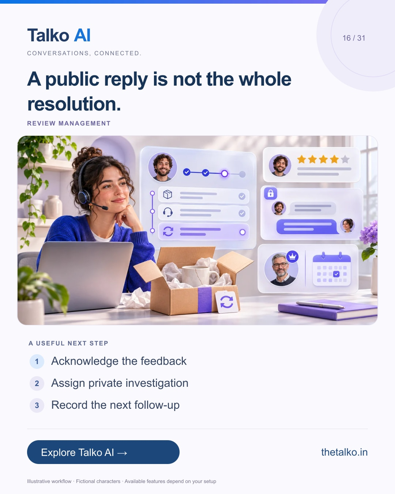

# 16 · A public reply is not the whole resolution.

Date: 2026-12-05
Pillar: Review management
Audience: Local business and support managers
Status: ready to schedule (not uploaded to a social account)

## Linkedin

Suggested publish time: 2026-12-05 14:30 IST

A thoughtful review reply should connect to real follow-through.

Acknowledging feedback publicly does not settle a delivery problem, a service concern or a request that needs investigation.

A practical workflow:
1. Acknowledge the feedback
2. Assign private investigation
3. Record the next follow-up

Keep personal details out of a public reply. A refund or replacement still needs confirmation from the system and person authorised to approve it.

Combine review replies, case ownership and follow-up tracking in a process your team can supervise.

How do you know whether a replied-to complaint was actually resolved?

Explore the workflow: https://www.thetalko.in/features?utm_source=linkedin&utm_medium=organic_social&utm_campaign=2026-11_to_2027-01_character_workflows&utm_content=complaints-need-an-owner

#TalkoAI #ReviewManagement #BusinessAutomation

## Instagram

Suggested publish time: 2026-12-05 19:00 IST

A thoughtful review reply should connect to real follow-through.

Acknowledging feedback publicly does not settle a delivery problem, a service concern or a request that needs investigation.

→ Acknowledge the feedback
→ Assign private investigation
→ Record the next follow-up

Keep personal details out of a public reply. A refund or replacement still needs confirmation from the system and person authorised to approve it.

Combine review replies, case ownership and follow-up tracking in a process your team can supervise.

Save this workflow for your next setup session. Explore Talko AI through the link in our bio.

How do you know whether a replied-to complaint was actually resolved?

#TalkoAI #ReviewManagement #BusinessAutomation #SmallBusiness #CustomerSupport

## Facebook

Suggested publish time: 2026-12-05 18:00 IST

A thoughtful review reply should connect to real follow-through.

Acknowledging feedback publicly does not settle a delivery problem, a service concern or a request that needs investigation.

Here is a useful place to start:
• Acknowledge the feedback
• Assign private investigation
• Record the next follow-up

Combine review replies, case ownership and follow-up tracking in a process your team can supervise. Keep personal details out of a public reply. A refund or replacement still needs confirmation from the system and person authorised to approve it.

How do you know whether a replied-to complaint was actually resolved?

See how it works: https://www.thetalko.in/features?utm_source=facebook&utm_medium=organic_social&utm_campaign=2026-11_to_2027-01_character_workflows&utm_content=complaints-need-an-owner

#TalkoAI #ReviewManagement #BusinessAutomation

## Keywords and accessibility

Keywords: Google review case management, complaint follow-up, service recovery workflow, review replies

Alt text: A public reply is not the whole resolution. A character-based illustration shows acknowledge the feedback, then assign private investigation, then record the next follow-up.

## Instagram link setup

Feed caption links are not treated as clickable. Keep a stable profile link: https://www.thetalko.in/?utm_source=instagram&utm_medium=organic_social&utm_campaign=2026-11_to_2027-01_character_workflows&utm_content=profile

Use this post-specific URL in a Story link sticker or relevant link hub: https://www.thetalko.in/features?utm_source=instagram&utm_medium=organic_story&utm_campaign=2026-11_to_2027-01_character_workflows&utm_content=complaints-need-an-owner

Artwork source: public/blog/holiday-returns-complaints-google-review-case-management.webp
AI-generated editorial illustration; fictional people and illustrative workflows.
