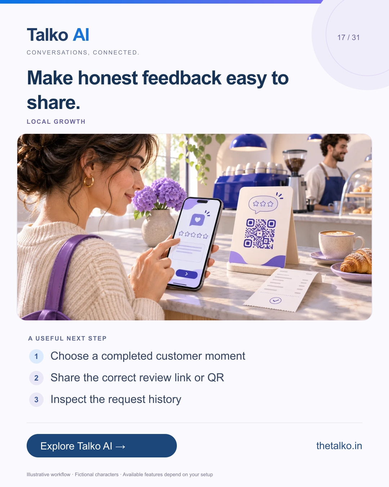

# 17 · Make honest feedback easy to share.

Date: 2026-12-07
Pillar: Local growth
Audience: Shops, cafes and service businesses
Status: ready to schedule (not uploaded to a social account)

## Linkedin

Suggested publish time: 2026-12-07 19:30 IST

A good review invitation starts with a genuine customer experience.

Staff need a repeatable way to share the right location link without turning the request into pressure for a positive rating.

A practical workflow:
1. Choose a completed customer moment
2. Share the correct review link or QR
3. Inspect the request history

Ask neutrally for honest feedback. Do not offer rewards for reviews, and test the branch destination before distributing a code.

Use Talko AI review-request tools to organise the process and spot operational problems.

When is the most natural moment to invite feedback in your business?

Explore the workflow: https://www.thetalko.in/features?utm_source=linkedin&utm_medium=organic_social&utm_campaign=2026-11_to_2027-01_character_workflows&utm_content=honest-review-invitation

#TalkoAI #ReviewManagement #BusinessAutomation

## Instagram

Suggested publish time: 2026-12-07 20:00 IST

A good review invitation starts with a genuine customer experience.

Staff need a repeatable way to share the right location link without turning the request into pressure for a positive rating.

→ Choose a completed customer moment
→ Share the correct review link or QR
→ Inspect the request history

Ask neutrally for honest feedback. Do not offer rewards for reviews, and test the branch destination before distributing a code.

Use Talko AI review-request tools to organise the process and spot operational problems.

Save this workflow for your next setup session. Explore Talko AI through the link in our bio.

When is the most natural moment to invite feedback in your business?

#TalkoAI #ReviewManagement #BusinessAutomation #SmallBusiness #CustomerSupport

## Facebook

Suggested publish time: 2026-12-07 19:00 IST

A good review invitation starts with a genuine customer experience.

Staff need a repeatable way to share the right location link without turning the request into pressure for a positive rating.

Here is a useful place to start:
• Choose a completed customer moment
• Share the correct review link or QR
• Inspect the request history

Use Talko AI review-request tools to organise the process and spot operational problems. Ask neutrally for honest feedback. Do not offer rewards for reviews, and test the branch destination before distributing a code.

When is the most natural moment to invite feedback in your business?

See how it works: https://www.thetalko.in/features?utm_source=facebook&utm_medium=organic_social&utm_campaign=2026-11_to_2027-01_character_workflows&utm_content=honest-review-invitation

#TalkoAI #ReviewManagement #BusinessAutomation

## Keywords and accessibility

Keywords: Google review requests, review QR code, local business feedback, reputation management

Alt text: Make honest feedback easy to share. A character-based illustration shows choose a completed customer moment, then share the correct review link or qr, then inspect the request history.

## Instagram link setup

Feed caption links are not treated as clickable. Keep a stable profile link: https://www.thetalko.in/?utm_source=instagram&utm_medium=organic_social&utm_campaign=2026-11_to_2027-01_character_workflows&utm_content=profile

Use this post-specific URL in a Story link sticker or relevant link hub: https://www.thetalko.in/features?utm_source=instagram&utm_medium=organic_story&utm_campaign=2026-11_to_2027-01_character_workflows&utm_content=honest-review-invitation

Artwork source: public/blog/google-review-requests-qr-codes-after-customer-visit.webp
AI-generated editorial illustration; fictional people and illustrative workflows.
