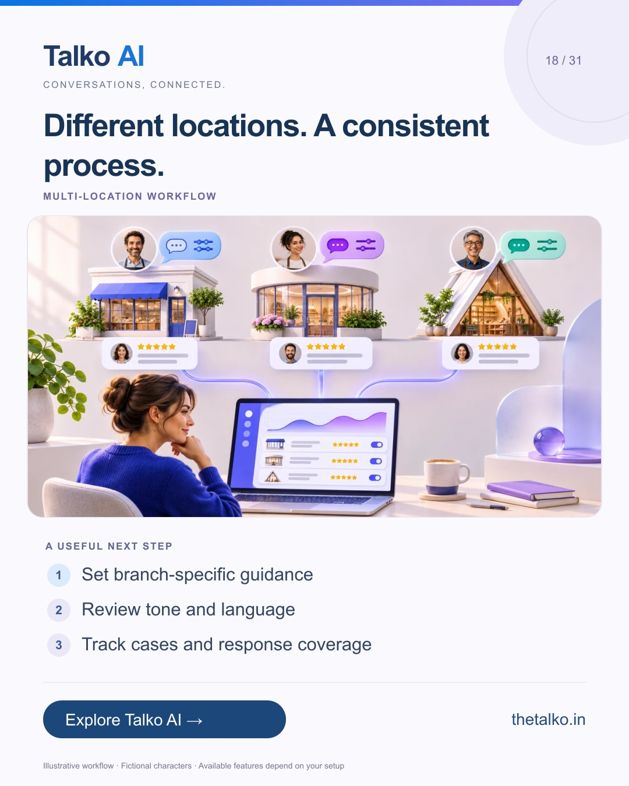

# 18 · Different locations. A consistent process.

Date: 2026-12-09
Pillar: Multi-location workflow
Audience: Multi-branch businesses and agencies
Status: ready to schedule (not uploaded to a social account)

## Linkedin

Suggested publish time: 2026-12-09 14:30 IST

Consistent review handling does not require identical replies.

Each location needs the correct identity, appropriate language and a responsible person for unresolved feedback.

A practical workflow:
1. Set branch-specific guidance
2. Review tone and language
3. Track cases and response coverage

Have a fluent reviewer check representative replies. Language matching is a setting to test, not a promise of perfect support in every language.

Bring location settings, reply guidance and reporting into the review-management process.

What should stay consistent across your locations, and what should stay local?

Explore the workflow: https://www.thetalko.in/pricing?utm_source=linkedin&utm_medium=organic_social&utm_campaign=2026-11_to_2027-01_character_workflows&utm_content=location-reply-guidance

#TalkoAI #ReviewManagement #BusinessAutomation

## Instagram

Suggested publish time: 2026-12-09 19:00 IST

Consistent review handling does not require identical replies.

Each location needs the correct identity, appropriate language and a responsible person for unresolved feedback.

→ Set branch-specific guidance
→ Review tone and language
→ Track cases and response coverage

Have a fluent reviewer check representative replies. Language matching is a setting to test, not a promise of perfect support in every language.

Bring location settings, reply guidance and reporting into the review-management process.

Save this workflow for your next setup session. Explore Talko AI through the link in our bio.

What should stay consistent across your locations, and what should stay local?

#TalkoAI #ReviewManagement #BusinessAutomation #SmallBusiness #CustomerSupport

## Facebook

Suggested publish time: 2026-12-09 18:00 IST

Consistent review handling does not require identical replies.

Each location needs the correct identity, appropriate language and a responsible person for unresolved feedback.

Here is a useful place to start:
• Set branch-specific guidance
• Review tone and language
• Track cases and response coverage

Bring location settings, reply guidance and reporting into the review-management process. Have a fluent reviewer check representative replies. Language matching is a setting to test, not a promise of perfect support in every language.

What should stay consistent across your locations, and what should stay local?

See how it works: https://www.thetalko.in/pricing?utm_source=facebook&utm_medium=organic_social&utm_campaign=2026-11_to_2027-01_character_workflows&utm_content=location-reply-guidance

#TalkoAI #ReviewManagement #BusinessAutomation

## Keywords and accessibility

Keywords: multi location reviews, Google Business Profile management, review reply language, branch customer experience

Alt text: Different locations. A consistent process. A character-based illustration shows set branch-specific guidance, then review tone and language, then track cases and response coverage.

## Instagram link setup

Feed caption links are not treated as clickable. Keep a stable profile link: https://www.thetalko.in/?utm_source=instagram&utm_medium=organic_social&utm_campaign=2026-11_to_2027-01_character_workflows&utm_content=profile

Use this post-specific URL in a Story link sticker or relevant link hub: https://www.thetalko.in/pricing?utm_source=instagram&utm_medium=organic_story&utm_campaign=2026-11_to_2027-01_character_workflows&utm_content=location-reply-guidance

Artwork source: public/blog/multi-location-google-reviews-language-reply-presets.webp
AI-generated editorial illustration; fictional people and illustrative workflows.
