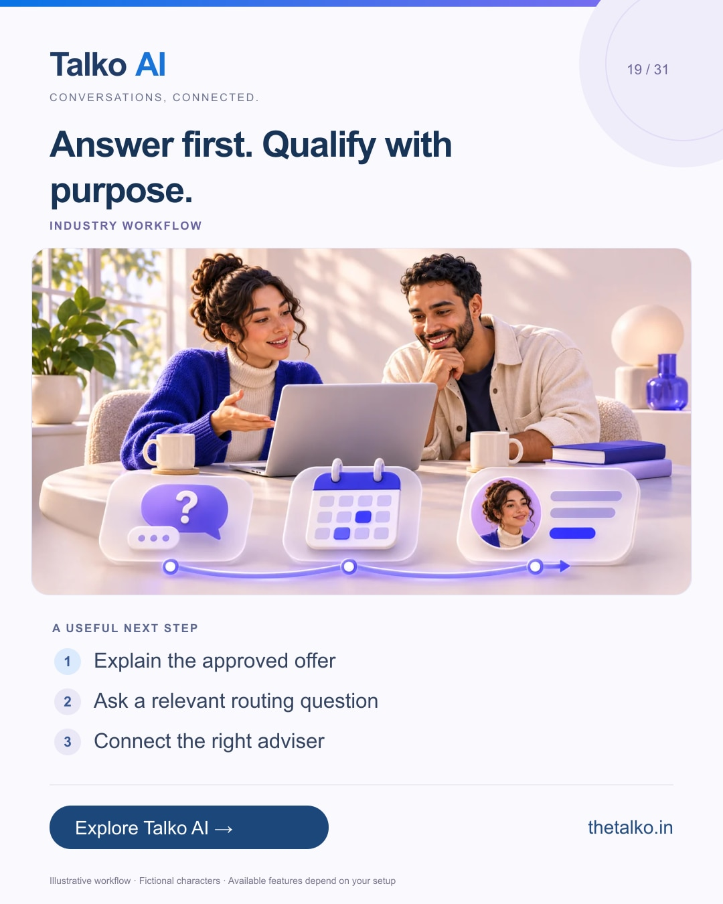

# 19 · Answer first. Qualify with purpose.

Date: 2026-12-11
Pillar: Industry workflow
Audience: Coaches, education and workshop businesses
Status: ready to schedule (not uploaded to a social account)

## Linkedin

Suggested publish time: 2026-12-11 19:30 IST

“Is this right for a beginner?” deserves an answer before a long form.

Collecting every sales field at once can make a simple course enquiry feel like an administrative task.

A practical workflow:
1. Explain the approved offer
2. Ask a relevant routing question
3. Connect the right adviser

Ask only for information that changes the next action. Confirm availability through the actual booking process before promising a place.

Use Talko AI flows and business knowledge to make education enquiries easier to handle.

Which qualification question genuinely changes your next action?

Explore the workflow: https://www.thetalko.in/industries/edtech?utm_source=linkedin&utm_medium=organic_social&utm_campaign=2026-11_to_2027-01_character_workflows&utm_content=workshop-enquiries

#TalkoAI #CustomerExperience #BusinessAutomation

## Instagram

Suggested publish time: 2026-12-11 20:00 IST

“Is this right for a beginner?” deserves an answer before a long form.

Collecting every sales field at once can make a simple course enquiry feel like an administrative task.

→ Explain the approved offer
→ Ask a relevant routing question
→ Connect the right adviser

Ask only for information that changes the next action. Confirm availability through the actual booking process before promising a place.

Use Talko AI flows and business knowledge to make education enquiries easier to handle.

Save this workflow for your next setup session. Explore Talko AI through the link in our bio.

Which qualification question genuinely changes your next action?

#TalkoAI #CustomerExperience #BusinessAutomation #SmallBusiness #CustomerSupport

## Facebook

Suggested publish time: 2026-12-11 19:00 IST

“Is this right for a beginner?” deserves an answer before a long form.

Collecting every sales field at once can make a simple course enquiry feel like an administrative task.

Here is a useful place to start:
• Explain the approved offer
• Ask a relevant routing question
• Connect the right adviser

Use Talko AI flows and business knowledge to make education enquiries easier to handle. Ask only for information that changes the next action. Confirm availability through the actual booking process before promising a place.

Which qualification question genuinely changes your next action?

See how it works: https://www.thetalko.in/industries/edtech?utm_source=facebook&utm_medium=organic_social&utm_campaign=2026-11_to_2027-01_character_workflows&utm_content=workshop-enquiries

#TalkoAI #CustomerExperience #BusinessAutomation

## Keywords and accessibility

Keywords: education lead qualification, workshop enquiries, coaching chatbot, course enquiry automation

Alt text: Answer first. Qualify with purpose. A character-based illustration shows explain the approved offer, then ask a relevant routing question, then connect the right adviser.

## Instagram link setup

Feed caption links are not treated as clickable. Keep a stable profile link: https://www.thetalko.in/?utm_source=instagram&utm_medium=organic_social&utm_campaign=2026-11_to_2027-01_character_workflows&utm_content=profile

Use this post-specific URL in a Story link sticker or relevant link hub: https://www.thetalko.in/industries/edtech?utm_source=instagram&utm_medium=organic_story&utm_campaign=2026-11_to_2027-01_character_workflows&utm_content=workshop-enquiries

Artwork source: public/marketing/stories/booking-enquiry.webp
AI-generated editorial illustration; fictional people and illustrative workflows.
