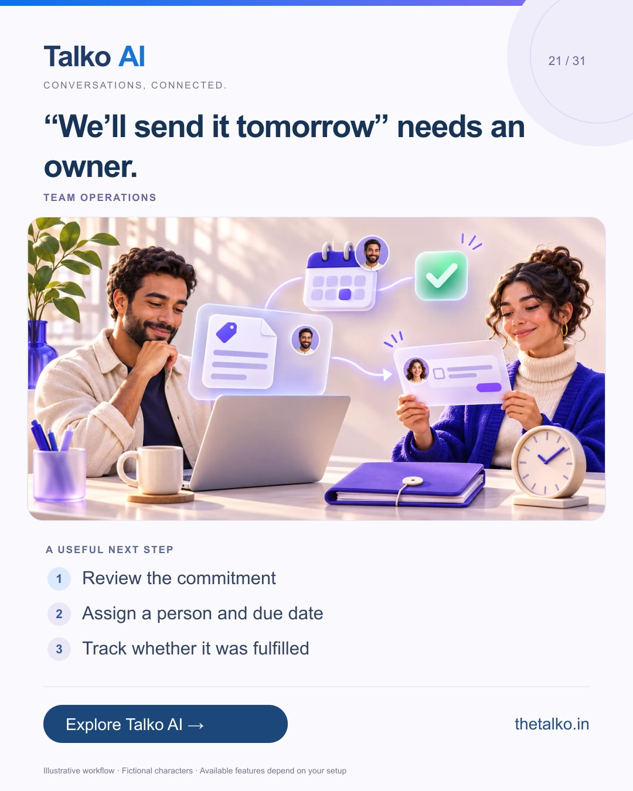

# 21 · “We’ll send it tomorrow” needs an owner.

Date: 2026-12-15
Pillar: Team operations
Audience: Service and sales managers
Status: ready to schedule (not uploaded to a social account)

## Linkedin

Suggested publish time: 2026-12-15 19:30 IST

A customer remembers the promise even when your team forgets the task.

Quotation follow-ups, requested details and internal handoffs can disappear between conversations without an owner and deadline.

A practical workflow:
1. Review the commitment
2. Assign a person and due date
3. Track whether it was fulfilled

Keep evidence of what was actually promised. Tracking a commitment should not invent an automated customer reminder.

Make team follow-through part of the customer journey instead of leaving it to memory.

Which promise would you most like your team to stop losing?

Explore the workflow: https://www.thetalko.in/features?utm_source=linkedin&utm_medium=organic_social&utm_campaign=2026-11_to_2027-01_character_workflows&utm_content=promise-follow-through#social-growth

#TalkoAI #CustomerExperience #BusinessAutomation

## Instagram

Suggested publish time: 2026-12-15 20:00 IST

A customer remembers the promise even when your team forgets the task.

Quotation follow-ups, requested details and internal handoffs can disappear between conversations without an owner and deadline.

→ Review the commitment
→ Assign a person and due date
→ Track whether it was fulfilled

Keep evidence of what was actually promised. Tracking a commitment should not invent an automated customer reminder.

Make team follow-through part of the customer journey instead of leaving it to memory.

Save this workflow for your next setup session. Explore Talko AI through the link in our bio.

Which promise would you most like your team to stop losing?

#TalkoAI #CustomerExperience #BusinessAutomation #SmallBusiness #CustomerSupport

## Facebook

Suggested publish time: 2026-12-15 19:00 IST

A customer remembers the promise even when your team forgets the task.

Quotation follow-ups, requested details and internal handoffs can disappear between conversations without an owner and deadline.

Here is a useful place to start:
• Review the commitment
• Assign a person and due date
• Track whether it was fulfilled

Make team follow-through part of the customer journey instead of leaving it to memory. Keep evidence of what was actually promised. Tracking a commitment should not invent an automated customer reminder.

Which promise would you most like your team to stop losing?

See how it works: https://www.thetalko.in/features?utm_source=facebook&utm_medium=organic_social&utm_campaign=2026-11_to_2027-01_character_workflows&utm_content=promise-follow-through#social-growth

#TalkoAI #CustomerExperience #BusinessAutomation

## Keywords and accessibility

Keywords: customer promise tracking, sales follow-through, team task ownership, quotation follow-up

Alt text: “We’ll send it tomorrow” needs an owner. A character-based illustration shows review the commitment, then assign a person and due date, then track whether it was fulfilled.

## Instagram link setup

Feed caption links are not treated as clickable. Keep a stable profile link: https://www.thetalko.in/?utm_source=instagram&utm_medium=organic_social&utm_campaign=2026-11_to_2027-01_character_workflows&utm_content=profile

Use this post-specific URL in a Story link sticker or relevant link hub: https://www.thetalko.in/features?utm_source=instagram&utm_medium=organic_story&utm_campaign=2026-11_to_2027-01_character_workflows&utm_content=promise-follow-through#social-growth

Artwork source: public/marketing/stories/team-follow-through.webp
AI-generated editorial illustration; fictional people and illustrative workflows.
