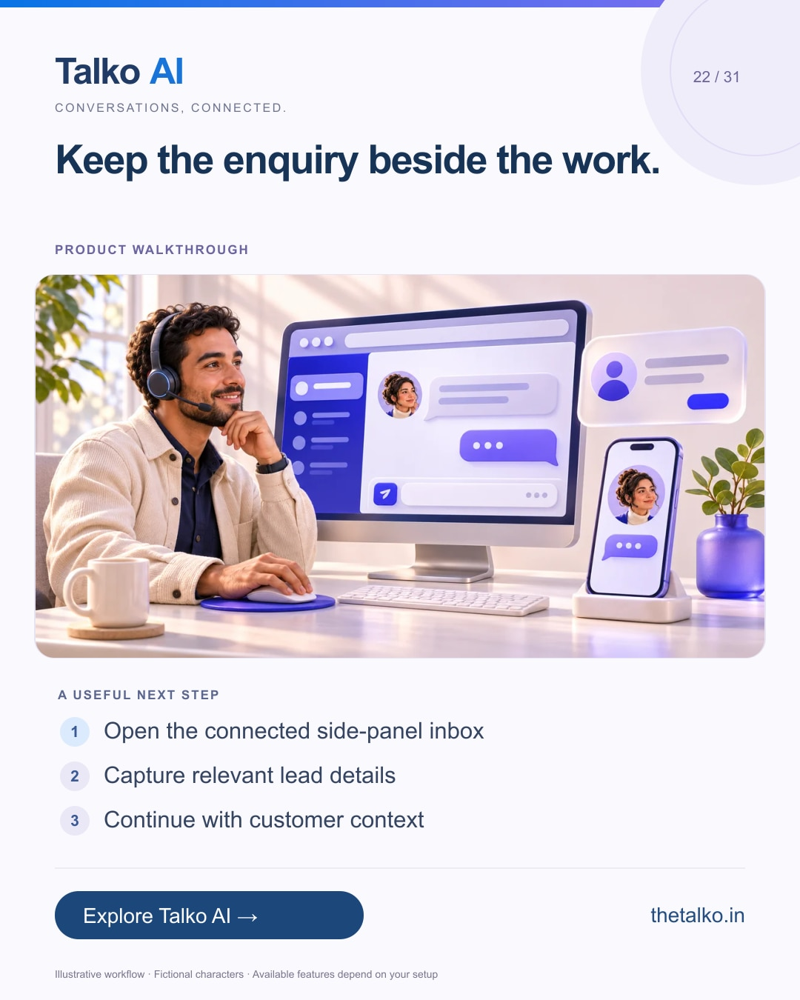

# 22 · Keep the enquiry beside the work.

Date: 2026-12-17
Pillar: Product walkthrough
Audience: Sales advisers and support operators
Status: ready to schedule (not uploaded to a social account)

## Linkedin

Suggested publish time: 2026-12-17 14:30 IST

You should not have to lose the customer thread to use another tab.

Browsing a prospect’s website, reviewing information and answering messages can become disconnected pieces of the same task.

A practical workflow:
1. Open the connected side-panel inbox
2. Capture relevant lead details
3. Continue with customer context

Use only the access and business information you are authorised to handle. A browser tool should support the workflow, not replace your review.

Explore the Talko Copilot extension as part of your customer-conversation setup.

Which tab switch most often interrupts your work?

Explore the workflow: https://www.thetalko.in/extension?utm_source=linkedin&utm_medium=organic_social&utm_campaign=2026-11_to_2027-01_character_workflows&utm_content=browser-side-panel

#TalkoAI #CustomerExperience #BusinessAutomation

## Instagram

Suggested publish time: 2026-12-17 19:00 IST

You should not have to lose the customer thread to use another tab.

Browsing a prospect’s website, reviewing information and answering messages can become disconnected pieces of the same task.

→ Open the connected side-panel inbox
→ Capture relevant lead details
→ Continue with customer context

Use only the access and business information you are authorised to handle. A browser tool should support the workflow, not replace your review.

Explore the Talko Copilot extension as part of your customer-conversation setup.

Save this workflow for your next setup session. Explore Talko AI through the link in our bio.

Which tab switch most often interrupts your work?

#TalkoAI #CustomerExperience #BusinessAutomation #SmallBusiness #CustomerSupport

## Facebook

Suggested publish time: 2026-12-17 18:00 IST

You should not have to lose the customer thread to use another tab.

Browsing a prospect’s website, reviewing information and answering messages can become disconnected pieces of the same task.

Here is a useful place to start:
• Open the connected side-panel inbox
• Capture relevant lead details
• Continue with customer context

Explore the Talko Copilot extension as part of your customer-conversation setup. Use only the access and business information you are authorised to handle. A browser tool should support the workflow, not replace your review.

Which tab switch most often interrupts your work?

See how it works: https://www.thetalko.in/extension?utm_source=facebook&utm_medium=organic_social&utm_campaign=2026-11_to_2027-01_character_workflows&utm_content=browser-side-panel

#TalkoAI #CustomerExperience #BusinessAutomation

## Keywords and accessibility

Keywords: CRM browser extension, customer inbox side panel, lead capture extension, Talko Copilot

Alt text: Keep the enquiry beside the work. A character-based illustration shows open the connected side-panel inbox, then capture relevant lead details, then continue with customer context.

## Instagram link setup

Feed caption links are not treated as clickable. Keep a stable profile link: https://www.thetalko.in/?utm_source=instagram&utm_medium=organic_social&utm_campaign=2026-11_to_2027-01_character_workflows&utm_content=profile

Use this post-specific URL in a Story link sticker or relevant link hub: https://www.thetalko.in/extension?utm_source=instagram&utm_medium=organic_story&utm_campaign=2026-11_to_2027-01_character_workflows&utm_content=browser-side-panel

Artwork source: public/marketing/stories/browser-copilot.webp
AI-generated editorial illustration; fictional people and illustrative workflows.
