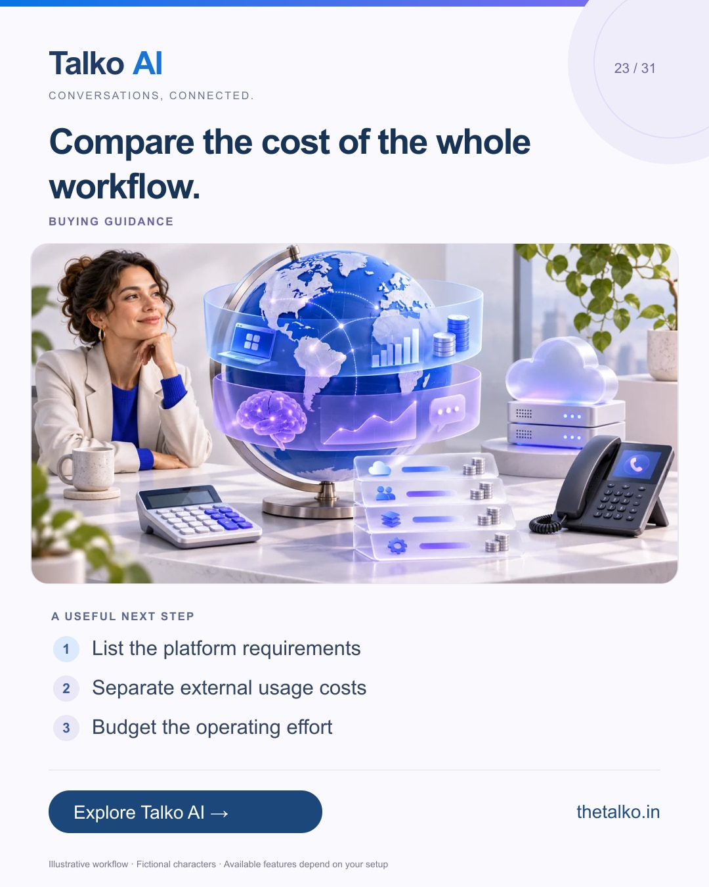

# 23 · Compare the cost of the whole workflow.

Date: 2026-12-19
Pillar: Buying guidance
Audience: International buyers and finance owners
Status: ready to schedule (not uploaded to a social account)

## Linkedin

Suggested publish time: 2026-12-19 19:30 IST

The subscription is one part of an automation budget.

Messaging usage, your configured AI provider, setup effort and the time needed to supervise the workflow also affect the decision.

A practical workflow:
1. List the platform requirements
2. Separate external usage costs
3. Budget the operating effort

Use your own market and volume assumptions. A price headline is not a complete international cost estimate.

Review Talko AI plans alongside the channels, team needs and usage your business expects.

Which cost is easiest to overlook in your current comparison?

Explore the workflow: https://www.thetalko.in/pricing?utm_source=linkedin&utm_medium=organic_social&utm_campaign=2026-11_to_2027-01_character_workflows&utm_content=budget-the-whole-workflow

#TalkoAI #WhatsAppAutomation #BusinessAutomation

## Instagram

Suggested publish time: 2026-12-19 20:00 IST

The subscription is one part of an automation budget.

Messaging usage, your configured AI provider, setup effort and the time needed to supervise the workflow also affect the decision.

→ List the platform requirements
→ Separate external usage costs
→ Budget the operating effort

Use your own market and volume assumptions. A price headline is not a complete international cost estimate.

Review Talko AI plans alongside the channels, team needs and usage your business expects.

Save this workflow for your next setup session. Explore Talko AI through the link in our bio.

Which cost is easiest to overlook in your current comparison?

#TalkoAI #WhatsAppAutomation #BusinessAutomation #SmallBusiness #CustomerSupport

## Facebook

Suggested publish time: 2026-12-19 19:00 IST

The subscription is one part of an automation budget.

Messaging usage, your configured AI provider, setup effort and the time needed to supervise the workflow also affect the decision.

Here is a useful place to start:
• List the platform requirements
• Separate external usage costs
• Budget the operating effort

Review Talko AI plans alongside the channels, team needs and usage your business expects. Use your own market and volume assumptions. A price headline is not a complete international cost estimate.

Which cost is easiest to overlook in your current comparison?

See how it works: https://www.thetalko.in/pricing?utm_source=facebook&utm_medium=organic_social&utm_campaign=2026-11_to_2027-01_character_workflows&utm_content=budget-the-whole-workflow

#TalkoAI #WhatsAppAutomation #BusinessAutomation

## Keywords and accessibility

Keywords: WhatsApp automation pricing, AI usage costs, international messaging budget, software total cost

Alt text: Compare the cost of the whole workflow. A character-based illustration shows list the platform requirements, then separate external usage costs, then budget the operating effort.

## Instagram link setup

Feed caption links are not treated as clickable. Keep a stable profile link: https://www.thetalko.in/?utm_source=instagram&utm_medium=organic_social&utm_campaign=2026-11_to_2027-01_character_workflows&utm_content=profile

Use this post-specific URL in a Story link sticker or relevant link hub: https://www.thetalko.in/pricing?utm_source=instagram&utm_medium=organic_story&utm_campaign=2026-11_to_2027-01_character_workflows&utm_content=budget-the-whole-workflow

Artwork source: public/blog/whatsapp-automation-total-cost-international-teams.webp
AI-generated editorial illustration; fictional people and illustrative workflows.
