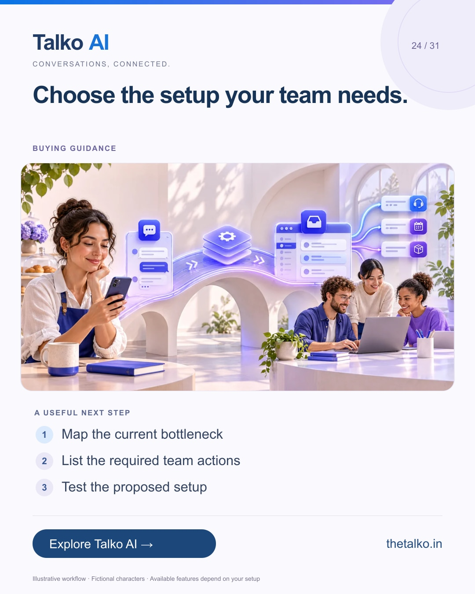

# 24 · Choose the setup your team needs.

Date: 2026-12-21
Pillar: Buying guidance
Audience: Businesses outgrowing manual messaging
Status: ready to schedule (not uploaded to a social account)

## Linkedin

Suggested publish time: 2026-12-21 14:30 IST

The right WhatsApp setup depends on the work your team needs to complete.

When ownership, repeatable qualification and integrations become difficult to manage by hand, it is time to define the workflow requirements.

A practical workflow:
1. Map the current bottleneck
2. List the required team actions
3. Test the proposed setup

Confirm number ownership, channel eligibility and the specific plan before changing a working setup. More features do not automatically mean a better fit.

Evaluate Talko AI using a real enquiry, an exception and the handoff your team needs.

What is the first sign your messaging process has outgrown manual coordination?

Explore the workflow: https://www.thetalko.in/features?utm_source=linkedin&utm_medium=organic_social&utm_campaign=2026-11_to_2027-01_character_workflows&utm_content=app-or-platform

#TalkoAI #WhatsAppAutomation #BusinessAutomation

## Instagram

Suggested publish time: 2026-12-21 19:00 IST

The right WhatsApp setup depends on the work your team needs to complete.

When ownership, repeatable qualification and integrations become difficult to manage by hand, it is time to define the workflow requirements.

→ Map the current bottleneck
→ List the required team actions
→ Test the proposed setup

Confirm number ownership, channel eligibility and the specific plan before changing a working setup. More features do not automatically mean a better fit.

Evaluate Talko AI using a real enquiry, an exception and the handoff your team needs.

Save this workflow for your next setup session. Explore Talko AI through the link in our bio.

What is the first sign your messaging process has outgrown manual coordination?

#TalkoAI #WhatsAppAutomation #BusinessAutomation #SmallBusiness #CustomerSupport

## Facebook

Suggested publish time: 2026-12-21 18:00 IST

The right WhatsApp setup depends on the work your team needs to complete.

When ownership, repeatable qualification and integrations become difficult to manage by hand, it is time to define the workflow requirements.

Here is a useful place to start:
• Map the current bottleneck
• List the required team actions
• Test the proposed setup

Evaluate Talko AI using a real enquiry, an exception and the handoff your team needs. Confirm number ownership, channel eligibility and the specific plan before changing a working setup. More features do not automatically mean a better fit.

What is the first sign your messaging process has outgrown manual coordination?

See how it works: https://www.thetalko.in/features?utm_source=facebook&utm_medium=organic_social&utm_campaign=2026-11_to_2027-01_character_workflows&utm_content=app-or-platform

#TalkoAI #WhatsAppAutomation #BusinessAutomation

## Keywords and accessibility

Keywords: WhatsApp Business App vs API, growing team inbox, automation platform evaluation, customer workflow

Alt text: Choose the setup your team needs. A character-based illustration shows map the current bottleneck, then list the required team actions, then test the proposed setup.

## Instagram link setup

Feed caption links are not treated as clickable. Keep a stable profile link: https://www.thetalko.in/?utm_source=instagram&utm_medium=organic_social&utm_campaign=2026-11_to_2027-01_character_workflows&utm_content=profile

Use this post-specific URL in a Story link sticker or relevant link hub: https://www.thetalko.in/features?utm_source=instagram&utm_medium=organic_story&utm_campaign=2026-11_to_2027-01_character_workflows&utm_content=app-or-platform

Artwork source: public/blog/whatsapp-business-app-vs-api-growing-teams.webp
AI-generated editorial illustration; fictional people and illustrative workflows.
