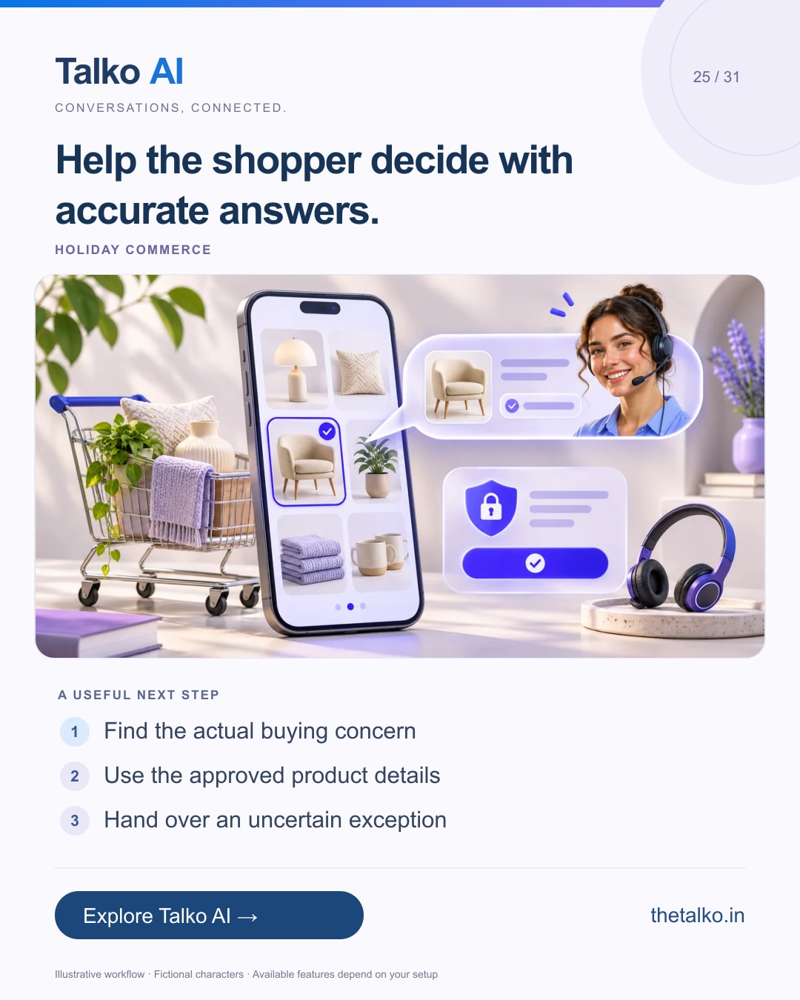

# 25 · Help the shopper decide with accurate answers.

Date: 2026-12-23
Pillar: Holiday commerce
Audience: Retail and online store teams
Status: ready to schedule (not uploaded to a social account)

## Linkedin

Suggested publish time: 2026-12-23 19:30 IST

A last-minute product question needs clarity, not a guessed promise.

A shopper may need to understand a product, a delivery estimate or the checkout steps before they can decide.

A practical workflow:
1. Find the actual buying concern
2. Use the approved product details
3. Hand over an uncertain exception

Do not guarantee a delivery date the business cannot verify. A clear limitation is more useful than an unsupported promise.

Use catalog conversations, AI knowledge and a human handoff to support the buying decision.

Which promise needs the most care in your holiday shopping conversations?

Explore the workflow: https://www.thetalko.in/industries/ecommerce?utm_source=linkedin&utm_medium=organic_social&utm_campaign=2026-11_to_2027-01_character_workflows&utm_content=last-minute-product-help

#TalkoAI #WhatsAppAutomation #BusinessAutomation

## Instagram

Suggested publish time: 2026-12-23 20:00 IST

A last-minute product question needs clarity, not a guessed promise.

A shopper may need to understand a product, a delivery estimate or the checkout steps before they can decide.

→ Find the actual buying concern
→ Use the approved product details
→ Hand over an uncertain exception

Do not guarantee a delivery date the business cannot verify. A clear limitation is more useful than an unsupported promise.

Use catalog conversations, AI knowledge and a human handoff to support the buying decision.

Save this workflow for your next setup session. Explore Talko AI through the link in our bio.

Which promise needs the most care in your holiday shopping conversations?

#TalkoAI #WhatsAppAutomation #BusinessAutomation #SmallBusiness #CustomerSupport

## Facebook

Suggested publish time: 2026-12-23 19:00 IST

A last-minute product question needs clarity, not a guessed promise.

A shopper may need to understand a product, a delivery estimate or the checkout steps before they can decide.

Here is a useful place to start:
• Find the actual buying concern
• Use the approved product details
• Hand over an uncertain exception

Use catalog conversations, AI knowledge and a human handoff to support the buying decision. Do not guarantee a delivery date the business cannot verify. A clear limitation is more useful than an unsupported promise.

Which promise needs the most care in your holiday shopping conversations?

See how it works: https://www.thetalko.in/industries/ecommerce?utm_source=facebook&utm_medium=organic_social&utm_campaign=2026-11_to_2027-01_character_workflows&utm_content=last-minute-product-help

#TalkoAI #WhatsAppAutomation #BusinessAutomation

## Keywords and accessibility

Keywords: holiday ecommerce support, product questions, WhatsApp catalog support, checkout assistance

Alt text: Help the shopper decide with accurate answers. A character-based illustration shows find the actual buying concern, then use the approved product details, then hand over an uncertain exception.

## Instagram link setup

Feed caption links are not treated as clickable. Keep a stable profile link: https://www.thetalko.in/?utm_source=instagram&utm_medium=organic_social&utm_campaign=2026-11_to_2027-01_character_workflows&utm_content=profile

Use this post-specific URL in a Story link sticker or relevant link hub: https://www.thetalko.in/industries/ecommerce?utm_source=instagram&utm_medium=organic_story&utm_campaign=2026-11_to_2027-01_character_workflows&utm_content=last-minute-product-help

Artwork source: public/blog/holiday-cart-recovery-whatsapp-catalog-follow-up.webp
AI-generated editorial illustration; fictional people and illustrative workflows.
