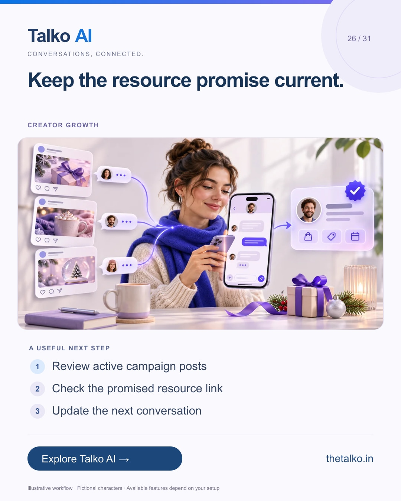

# 26 · Keep the resource promise current.

Date: 2026-12-25
Pillar: Creator growth
Audience: Creators and campaign managers
Status: ready to schedule (not uploaded to a social account)

## Linkedin

Suggested publish time: 2026-12-25 14:30 IST

A useful resource can outlive the post that introduced it.

An old guide link, expired offer or mismatched opening message can turn a successful comment campaign into a confusing experience.

A practical workflow:
1. Review active campaign posts
2. Check the promised resource link
3. Update the next conversation

Treat seasonal link and offer checks as part of campaign maintenance. Review ongoing messaging permissions separately from resource delivery.

Connect the content promise, delivered resource and next enquiry with Talko AI.

When did you last check the links behind your active comment campaigns?

Explore the workflow: https://www.thetalko.in/features?utm_source=linkedin&utm_medium=organic_social&utm_campaign=2026-11_to_2027-01_character_workflows&utm_content=resource-links-stay-current#social-growth

#TalkoAI #InstagramAutomation #BusinessAutomation

## Instagram

Suggested publish time: 2026-12-25 19:00 IST

A useful resource can outlive the post that introduced it.

An old guide link, expired offer or mismatched opening message can turn a successful comment campaign into a confusing experience.

→ Review active campaign posts
→ Check the promised resource link
→ Update the next conversation

Treat seasonal link and offer checks as part of campaign maintenance. Review ongoing messaging permissions separately from resource delivery.

Connect the content promise, delivered resource and next enquiry with Talko AI.

Save this workflow for your next setup session. Explore Talko AI through the link in our bio.

When did you last check the links behind your active comment campaigns?

#TalkoAI #InstagramAutomation #BusinessAutomation #SmallBusiness #CustomerSupport

## Facebook

Suggested publish time: 2026-12-25 18:00 IST

A useful resource can outlive the post that introduced it.

An old guide link, expired offer or mismatched opening message can turn a successful comment campaign into a confusing experience.

Here is a useful place to start:
• Review active campaign posts
• Check the promised resource link
• Update the next conversation

Connect the content promise, delivered resource and next enquiry with Talko AI. Treat seasonal link and offer checks as part of campaign maintenance. Review ongoing messaging permissions separately from resource delivery.

When did you last check the links behind your active comment campaigns?

See how it works: https://www.thetalko.in/features?utm_source=facebook&utm_medium=organic_social&utm_campaign=2026-11_to_2027-01_character_workflows&utm_content=resource-links-stay-current#social-growth

#TalkoAI #InstagramAutomation #BusinessAutomation

## Keywords and accessibility

Keywords: Instagram resource delivery, campaign link maintenance, comment to DM workflow, creator customer journey

Alt text: Keep the resource promise current. A character-based illustration shows review active campaign posts, then check the promised resource link, then update the next conversation.

## Instagram link setup

Feed caption links are not treated as clickable. Keep a stable profile link: https://www.thetalko.in/?utm_source=instagram&utm_medium=organic_social&utm_campaign=2026-11_to_2027-01_character_workflows&utm_content=profile

Use this post-specific URL in a Story link sticker or relevant link hub: https://www.thetalko.in/features?utm_source=instagram&utm_medium=organic_story&utm_campaign=2026-11_to_2027-01_character_workflows&utm_content=resource-links-stay-current#social-growth

Artwork source: public/blog/instagram-holiday-campaign-comments-to-qualified-leads.webp
AI-generated editorial illustration; fictional people and illustrative workflows.
