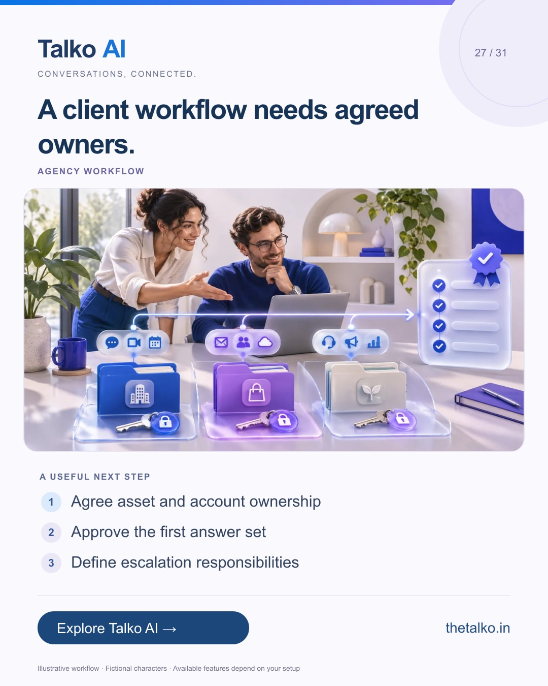

# 27 · A client workflow needs agreed owners.

Date: 2026-12-27
Pillar: Agency workflow
Audience: Agencies planning January retainers
Status: ready to schedule (not uploaded to a social account)

## Linkedin

Suggested publish time: 2026-12-27 19:30 IST

The handoff between an agency and its client deserves its own checklist.

After launch, someone must approve knowledge changes, review failed connections and respond when a lead needs a person.

A practical workflow:
1. Agree asset and account ownership
2. Approve the first answer set
3. Define escalation responsibilities

Separate the software subscription, external usage and agency service responsibilities. Confirm the actual account structure with the provider.

Build an onboarding process that makes the first customer workflow easy to supervise.

What do you wish every client had agreed before launch?

Explore the workflow: https://www.thetalko.in/contact?utm_source=linkedin&utm_medium=organic_social&utm_campaign=2026-11_to_2027-01_character_workflows&utm_content=agency-onboarding-checklist

#TalkoAI #WhatsAppAutomation #BusinessAutomation

## Instagram

Suggested publish time: 2026-12-27 20:00 IST

The handoff between an agency and its client deserves its own checklist.

After launch, someone must approve knowledge changes, review failed connections and respond when a lead needs a person.

→ Agree asset and account ownership
→ Approve the first answer set
→ Define escalation responsibilities

Separate the software subscription, external usage and agency service responsibilities. Confirm the actual account structure with the provider.

Build an onboarding process that makes the first customer workflow easy to supervise.

Save this workflow for your next setup session. Explore Talko AI through the link in our bio.

What do you wish every client had agreed before launch?

#TalkoAI #WhatsAppAutomation #BusinessAutomation #SmallBusiness #CustomerSupport

## Facebook

Suggested publish time: 2026-12-27 19:00 IST

The handoff between an agency and its client deserves its own checklist.

After launch, someone must approve knowledge changes, review failed connections and respond when a lead needs a person.

Here is a useful place to start:
• Agree asset and account ownership
• Approve the first answer set
• Define escalation responsibilities

Build an onboarding process that makes the first customer workflow easy to supervise. Separate the software subscription, external usage and agency service responsibilities. Confirm the actual account structure with the provider.

What do you wish every client had agreed before launch?

See how it works: https://www.thetalko.in/contact?utm_source=facebook&utm_medium=organic_social&utm_campaign=2026-11_to_2027-01_character_workflows&utm_content=agency-onboarding-checklist

#TalkoAI #WhatsAppAutomation #BusinessAutomation

## Keywords and accessibility

Keywords: agency onboarding checklist, WhatsApp automation services, client support handoff, automation delivery

Alt text: A client workflow needs agreed owners. A character-based illustration shows agree asset and account ownership, then approve the first answer set, then define escalation responsibilities.

## Instagram link setup

Feed caption links are not treated as clickable. Keep a stable profile link: https://www.thetalko.in/?utm_source=instagram&utm_medium=organic_social&utm_campaign=2026-11_to_2027-01_character_workflows&utm_content=profile

Use this post-specific URL in a Story link sticker or relevant link hub: https://www.thetalko.in/contact?utm_source=instagram&utm_medium=organic_story&utm_campaign=2026-11_to_2027-01_character_workflows&utm_content=agency-onboarding-checklist

Artwork source: public/blog/whatsapp-automation-agencies-client-onboarding.webp
AI-generated editorial illustration; fictional people and illustrative workflows.
