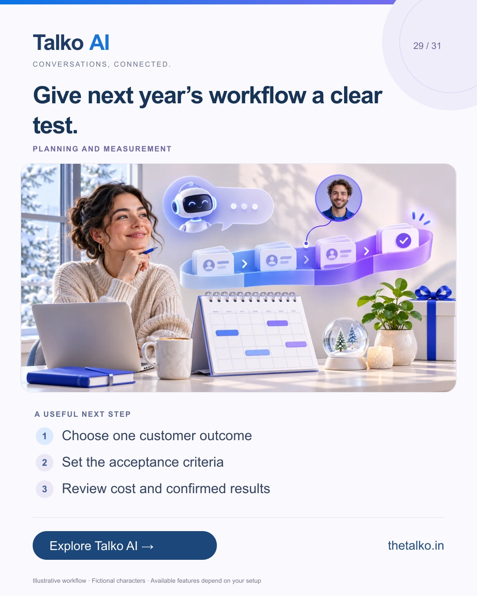

# 29 · Give next year’s workflow a clear test.

Date: 2026-12-31
Pillar: Planning and measurement
Audience: Founders and operations leaders
Status: ready to schedule (not uploaded to a social account)

## Linkedin

Suggested publish time: 2026-12-31 19:30 IST

A new-year automation goal becomes useful when the team can test it.

“Use more AI” is difficult to evaluate. “Route a qualified enquiry to a named owner” gives the team something concrete to inspect.

A practical workflow:
1. Choose one customer outcome
2. Set the acceptance criteria
3. Review cost and confirmed results

Do not claim a revenue lift from activity counts alone. Keep setup, messaging, AI and supervision effort in the pilot review.

Start a Talko AI trial around a workflow with an owner and a measurable next step.

What result would make your first January pilot worth continuing?

Explore the workflow: https://www.thetalko.in/signup?utm_source=linkedin&utm_medium=organic_social&utm_campaign=2026-11_to_2027-01_character_workflows&utm_content=new-year-pilot

#TalkoAI #CustomerExperience #BusinessAutomation

## Instagram

Suggested publish time: 2026-12-31 20:00 IST

A new-year automation goal becomes useful when the team can test it.

“Use more AI” is difficult to evaluate. “Route a qualified enquiry to a named owner” gives the team something concrete to inspect.

→ Choose one customer outcome
→ Set the acceptance criteria
→ Review cost and confirmed results

Do not claim a revenue lift from activity counts alone. Keep setup, messaging, AI and supervision effort in the pilot review.

Start a Talko AI trial around a workflow with an owner and a measurable next step.

Save this workflow for your next setup session. Explore Talko AI through the link in our bio.

What result would make your first January pilot worth continuing?

#TalkoAI #CustomerExperience #BusinessAutomation #SmallBusiness #CustomerSupport

## Facebook

Suggested publish time: 2026-12-31 19:00 IST

A new-year automation goal becomes useful when the team can test it.

“Use more AI” is difficult to evaluate. “Route a qualified enquiry to a named owner” gives the team something concrete to inspect.

Here is a useful place to start:
• Choose one customer outcome
• Set the acceptance criteria
• Review cost and confirmed results

Start a Talko AI trial around a workflow with an owner and a measurable next step. Do not claim a revenue lift from activity counts alone. Keep setup, messaging, AI and supervision effort in the pilot review.

What result would make your first January pilot worth continuing?

See how it works: https://www.thetalko.in/signup?utm_source=facebook&utm_medium=organic_social&utm_campaign=2026-11_to_2027-01_character_workflows&utm_content=new-year-pilot

#TalkoAI #CustomerExperience #BusinessAutomation

## Keywords and accessibility

Keywords: new year automation plan, AI pilot evaluation, sales pipeline workflow, measurable customer outcomes

Alt text: Give next year’s workflow a clear test. A character-based illustration shows choose one customer outcome, then set the acceptance criteria, then review cost and confirmed results.

## Instagram link setup

Feed caption links are not treated as clickable. Keep a stable profile link: https://www.thetalko.in/?utm_source=instagram&utm_medium=organic_social&utm_campaign=2026-11_to_2027-01_character_workflows&utm_content=profile

Use this post-specific URL in a Story link sticker or relevant link hub: https://www.thetalko.in/signup?utm_source=instagram&utm_medium=organic_story&utm_campaign=2026-11_to_2027-01_character_workflows&utm_content=new-year-pilot

Artwork source: public/blog/january-enquiry-pipeline-ai-qualification-follow-ups.webp
AI-generated editorial illustration; fictional people and illustrative workflows.
