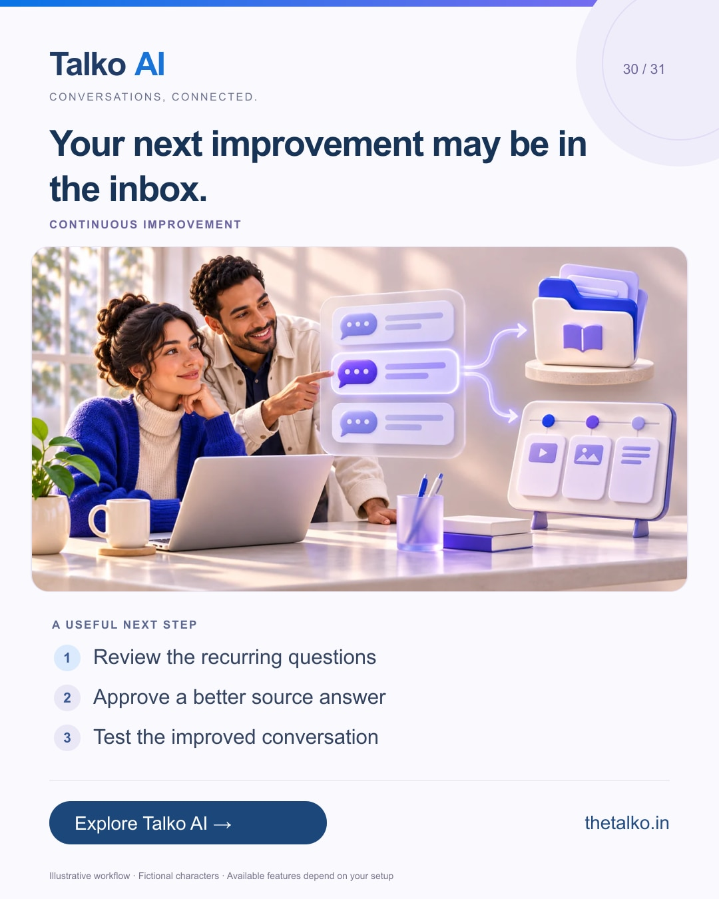

# 30 · Your next improvement may be in the inbox.

Date: 2027-01-02
Pillar: Continuous improvement
Audience: Content and customer experience teams
Status: ready to schedule (not uploaded to a social account)

## Linkedin

Suggested publish time: 2027-01-02 14:30 IST

Repeated customer questions are useful product and content input.

The same unanswered topic appearing in several conversations can reveal a gap in your knowledge, onboarding or next campaign.

A practical workflow:
1. Review the recurring questions
2. Approve a better source answer
3. Test the improved conversation

Have a person review the insight and the new answer before publishing a business claim. A repeated question is a signal to investigate, not proof of demand volume.

Let real conversations guide a more useful answer set and a clearer customer journey.

Which recurring question should become your next guide or FAQ?

Explore the workflow: https://www.thetalko.in/features?utm_source=linkedin&utm_medium=organic_social&utm_campaign=2026-11_to_2027-01_character_workflows&utm_content=questions-to-better-knowledge#social-growth

#TalkoAI #CustomerExperience #BusinessAutomation

## Instagram

Suggested publish time: 2027-01-02 19:00 IST

Repeated customer questions are useful product and content input.

The same unanswered topic appearing in several conversations can reveal a gap in your knowledge, onboarding or next campaign.

→ Review the recurring questions
→ Approve a better source answer
→ Test the improved conversation

Have a person review the insight and the new answer before publishing a business claim. A repeated question is a signal to investigate, not proof of demand volume.

Let real conversations guide a more useful answer set and a clearer customer journey.

Save this workflow for your next setup session. Explore Talko AI through the link in our bio.

Which recurring question should become your next guide or FAQ?

#TalkoAI #CustomerExperience #BusinessAutomation #SmallBusiness #CustomerSupport

## Facebook

Suggested publish time: 2027-01-02 18:00 IST

Repeated customer questions are useful product and content input.

The same unanswered topic appearing in several conversations can reveal a gap in your knowledge, onboarding or next campaign.

Here is a useful place to start:
• Review the recurring questions
• Approve a better source answer
• Test the improved conversation

Let real conversations guide a more useful answer set and a clearer customer journey. Have a person review the insight and the new answer before publishing a business claim. A repeated question is a signal to investigate, not proof of demand volume.

Which recurring question should become your next guide or FAQ?

See how it works: https://www.thetalko.in/features?utm_source=facebook&utm_medium=organic_social&utm_campaign=2026-11_to_2027-01_character_workflows&utm_content=questions-to-better-knowledge#social-growth

#TalkoAI #CustomerExperience #BusinessAutomation

## Keywords and accessibility

Keywords: customer conversation insights, FAQ improvement, knowledge base maintenance, customer-led content

Alt text: Your next improvement may be in the inbox. A character-based illustration shows review the recurring questions, then approve a better source answer, then test the improved conversation.

## Instagram link setup

Feed caption links are not treated as clickable. Keep a stable profile link: https://www.thetalko.in/?utm_source=instagram&utm_medium=organic_social&utm_campaign=2026-11_to_2027-01_character_workflows&utm_content=profile

Use this post-specific URL in a Story link sticker or relevant link hub: https://www.thetalko.in/features?utm_source=instagram&utm_medium=organic_story&utm_campaign=2026-11_to_2027-01_character_workflows&utm_content=questions-to-better-knowledge#social-growth

Artwork source: public/marketing/stories/customer-insights.webp
AI-generated editorial illustration; fictional people and illustrative workflows.
