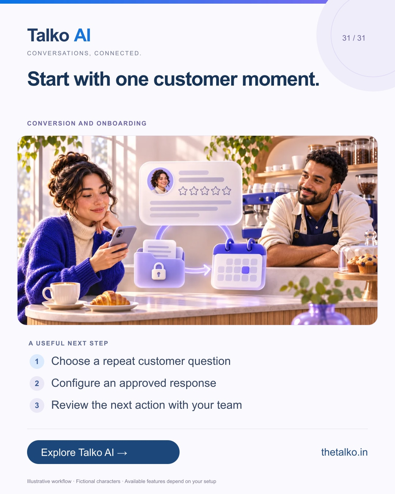

# 31 · Start with one customer moment.

Date: 2027-01-04
Pillar: Conversion and onboarding
Audience: Local and service business owners
Status: ready to schedule (not uploaded to a social account)

## Linkedin

Suggested publish time: 2027-01-04 19:30 IST

One enquiry. One review. One useful next step.

A small business does not need a complicated automation project to evaluate whether a connected workflow helps its team.

A practical workflow:
1. Choose a repeat customer question
2. Configure an approved response
3. Review the next action with your team

Pick the plan and channels that fit the first workflow. Expand after you can explain what worked, what failed and who owns the exception.

Try Talko AI with a real business question and a clear human fallback.

Which customer moment will you make easier first?

Explore the workflow: https://www.thetalko.in/signup?utm_source=linkedin&utm_medium=organic_social&utm_campaign=2026-11_to_2027-01_character_workflows&utm_content=one-customer-moment

#TalkoAI #ReviewManagement #BusinessAutomation

## Instagram

Suggested publish time: 2027-01-04 20:00 IST

One enquiry. One review. One useful next step.

A small business does not need a complicated automation project to evaluate whether a connected workflow helps its team.

→ Choose a repeat customer question
→ Configure an approved response
→ Review the next action with your team

Pick the plan and channels that fit the first workflow. Expand after you can explain what worked, what failed and who owns the exception.

Try Talko AI with a real business question and a clear human fallback.

Save this workflow for your next setup session. Explore Talko AI through the link in our bio.

Which customer moment will you make easier first?

#TalkoAI #ReviewManagement #BusinessAutomation #SmallBusiness #CustomerSupport

## Facebook

Suggested publish time: 2027-01-04 19:00 IST

One enquiry. One review. One useful next step.

A small business does not need a complicated automation project to evaluate whether a connected workflow helps its team.

Here is a useful place to start:
• Choose a repeat customer question
• Configure an approved response
• Review the next action with your team

Try Talko AI with a real business question and a clear human fallback. Pick the plan and channels that fit the first workflow. Expand after you can explain what worked, what failed and who owns the exception.

Which customer moment will you make easier first?

See how it works: https://www.thetalko.in/signup?utm_source=facebook&utm_medium=organic_social&utm_campaign=2026-11_to_2027-01_character_workflows&utm_content=one-customer-moment

#TalkoAI #ReviewManagement #BusinessAutomation

## Keywords and accessibility

Keywords: small business AI automation, customer experience workflow, Google review management, Talko AI trial

Alt text: Start with one customer moment. A character-based illustration shows choose a repeat customer question, then configure an approved response, then review the next action with your team.

## Instagram link setup

Feed caption links are not treated as clickable. Keep a stable profile link: https://www.thetalko.in/?utm_source=instagram&utm_medium=organic_social&utm_campaign=2026-11_to_2027-01_character_workflows&utm_content=profile

Use this post-specific URL in a Story link sticker or relevant link hub: https://www.thetalko.in/signup?utm_source=instagram&utm_medium=organic_story&utm_campaign=2026-11_to_2027-01_character_workflows&utm_content=one-customer-moment

Artwork source: public/marketing/stories/reviews-local-business.webp
AI-generated editorial illustration; fictional people and illustrative workflows.
